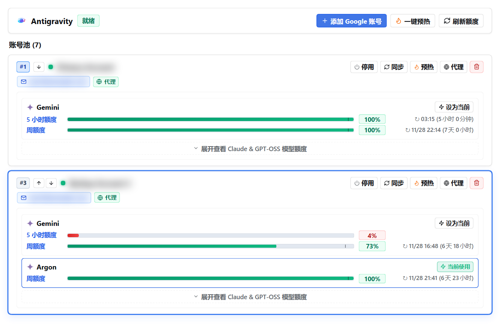
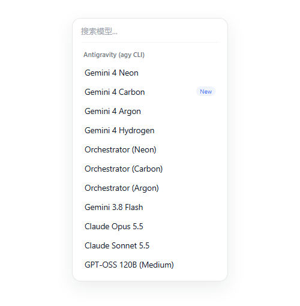
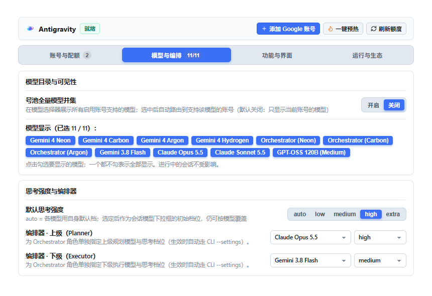
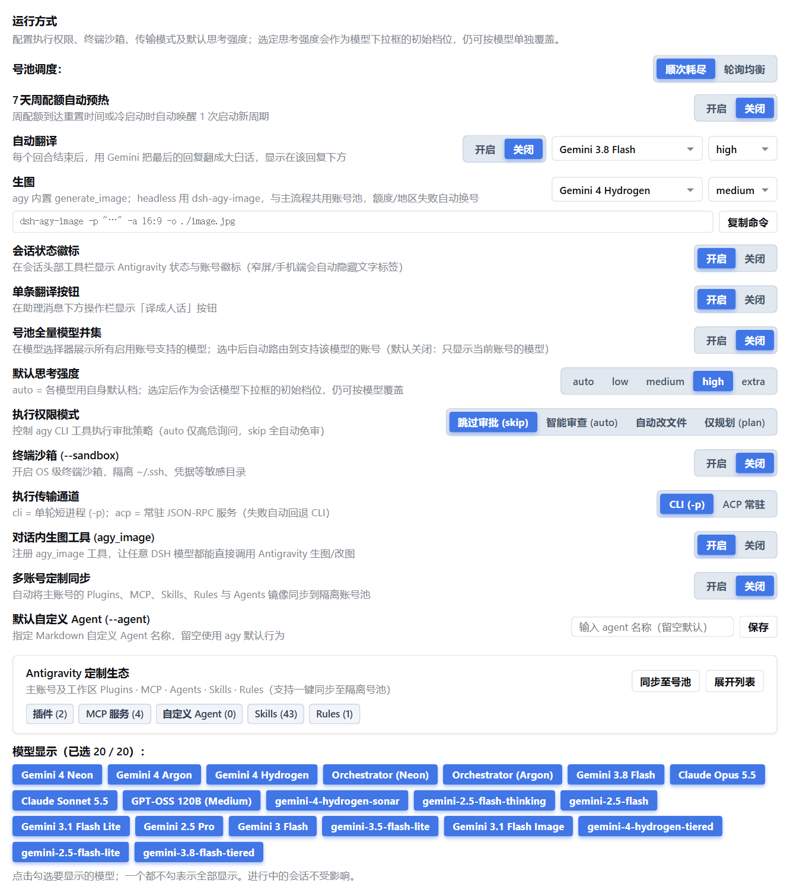
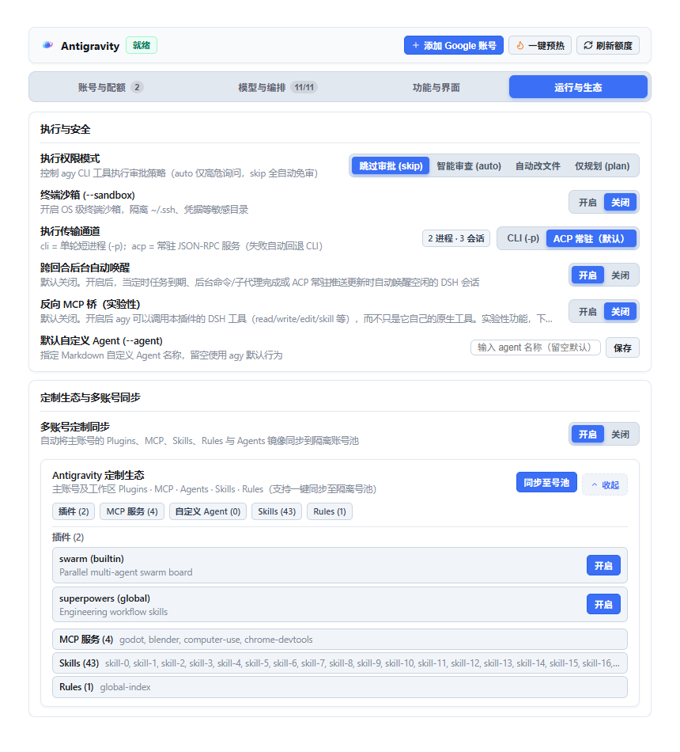
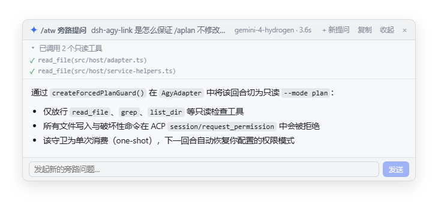
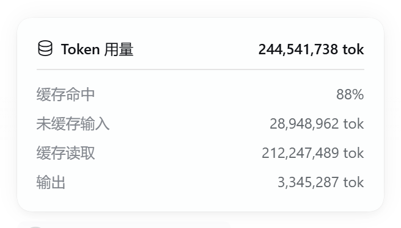
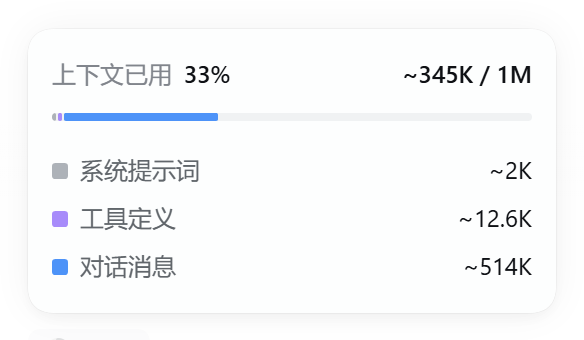

<h1 align="center">🛰️ dsh-agy-link</h1>

<p align="center">
  <b>DeepSeek Harness × Google Antigravity</b> — 多账号智能池化与官方 agy CLI / ACP 双通道桥接 / Multi-Account Pool & Native agy CLI / ACP Bridge for DSH
</p>

<p align="center">
  <a href="https://www.npmjs.com/package/dsh-agy-link"></a>
  <a href="https://github.com/amlyczz/dsh-agy-link/actions/workflows/ci.yml"></a>
  
  
  =1.5"/>
</p>

<p align="center">
  <b>🌐 语言：</b>
  <a href="./docs/README.en.md">English</a> ·
  <a href="./docs/CONFIGURATION.md">完整配置文档</a> ·
  <a href="./docs/ARCHITECTURE.md">架构说明</a> ·
  <a href="./docs/SECURITY-NOTES.md">安全说明</a>
</p>

---

# 中文

把 **Google Antigravity 模型接入 DeepSeek Harness（DSH）** —— 支持**按模型族独立路由的多账号智能池化**、**CLI 优先官方多 Bucket 配额监控（5 小时滚动 + 7 天周额度 + Argon 独立周池）**、**短进程 `-p` 与持久化 `agy acp` 双传输模式**、**浏览器免粘贴一键登录**、**对话内生图（`agy_image` / `/agy image` / `dsh-agy-image`）**、**多模态附件与 Generative UI 内嵌渲染**，以及**多账号定制生态白名单同步**。由官方未修改的 `agy` CLI 驱动，完整支持流式输出、思考折叠、原生工具卡片与 1M 物理上下文精确计量。

<p align="center">
  
</p>
<p align="center">
  
  &nbsp;&nbsp;
  
</p>
<p align="center">
  
  &nbsp;&nbsp;
  
</p>
<p align="center">
  
</p>
<p align="center">
  
  &nbsp;&nbsp;
  
</p>

---

> 🚨 **【国内用户核心前置：必须开启系统代理 / TUN 模式！】**
>
> Google Antigravity 服务及 OAuth 登录需要直连 Google 海外服务器（`oauth2.googleapis.com`、`daily-cloudcode-pa.googleapis.com` 等）。
>
> 1. **推荐方式（最稳妥）**：开启代理工具（Clash / Surge / v2rayA / Sing-box / Loon 等）的 **TUN 虚拟网卡模式（或系统代理全局接管）**，确保终端命令、后台 Node.js 进程及浏览器均能顺畅访问 Google 网络。
> 2. **终端代理环境变量**：若终端未被代理自动接管，启动 DSH 或运行命令前请在终端中执行：
>    ```bash
>    export HTTPS_PROXY=http://127.0.0.1:7890 HTTP_PROXY=http://127.0.0.1:7890 ALL_PROXY=socks5://127.0.0.1:7890
>    ```
>    *(注：端口 `7890` 请替换为你本地代理软件的实际端口)*
> 3. **GUI 单账号独立代理**：进入 DSH「设置 → 插件 → Antigravity」或点击顶部 `AGY` 徽标，点击卡片上的「🌐 代理」按钮，可为特定账号单独绑定专属代理 URL，实现多账号不同 IP 出口隔离。

---

## 🌟 核心能力：多账号池化与风控防封

拥有多个 Google Antigravity / Gemini 账号？**dsh-agy-link 让多账号管理自动化、可视化且风控友好**：

- 👥 **多账号池化与独立沙箱**：在 DSH 内添加任意数量的 Google 账号，每个备用账号拥有独立 HOME 目录沙箱与 `0600` 原子化凭证（带 `.bak` 自愈备份）。Windows 上以「身份级引用计数租约」接管机器级 `gemini:antigravity` 凭据槽，**同一账号的多会话并行运行**，仅跨账号切换时短暂串行交接。
- ⚡ **按模型族独立切换与冷却 (`Gemini` / `Argon` / `Claude` / `GPT-OSS`)**：控制台每个模型族独立显示「设为当前 / 当前使用」并支持独立冷却与清除冷却；某个模型族限流不影响其余模型族正常调度。
- 🔄 **顺序耗尽 & 到期优先轮换**：支持 `sequential`（顺次耗尽）与 `round-robin`（轮询均衡）调度；触发 429 或额度耗尽时自动平滑接力至重置窗口最早到期的可用账号，对话不中断。
- 📊 **CLI 优先多 Bucket 配额监控与自动预热**：默认通过官方 `agy -p /usage` 采集配额（`quotaViaCli: true`），同时展示 **5 小时额度**、**周额度**（以及服务端上报时的 **Argon 独立周池**）与消耗节奏指示；支持单账号/一键预热及宿主驱动的持久化预热进度条，可按需开启到达重置窗口自动预热（`autoWarmup`）。
- 🧠 **抖动安全鉴权与风控熔断**：基于 agy 运行日志的 `keyringAuth` 传输证据精准区分代理抖动（自动按 `NETWORK` 重试）与真实登出（粘性 `authRequired` 需二次确认），绝不误伤健康账号；遇 `TOS_VIOLATION` 立即隔离该账号并停止自动故障转移，防止连坐封号。
- 🔑 **浏览器免粘贴 OAuth 与 Token 导入**：支持一键唤起系统浏览器回环自动捕获凭证（含手动回调粘贴兜底）及 `refresh_token` / Token JSON 直接导入。
- 🌐 **独立账号代理**：每个账号可单独配置 HTTP(S) / SOCKS 代理，未配置时回退全局代理或自动探测系统代理。

---

## ✨ 全功能特性一览

| 能力 | 说明 |
| --- | --- |
| 🎨 **官方专属品牌与 4 标签控制台** | `assets/icon.svg` 矢量微标自适应深浅主题；顶部 `AGY · 别名` 徽标弹窗与「设置 → 插件 → Antigravity」共用 **账号与配额 / 模型与编排 / 功能与界面 / 运行与生态** 4 标签控制台，窄屏自动切换全屏抽屉并支持触控重排 |
| 📋 **按账号真实模型目录与编排器配置** | 同步 `agy 1.5.16`（含 `Gemini 4 Carbon` 与 `Orchestrator`）模型目录，提供允许清单勾选（`selectedModels`）、`poolWideCatalog` 并集路由、动态思考档自愈，以及 Orchestrator 上级 Planner / 下级 Executor 独立模型配置 |
| 🛡️ **4 档权限模式、OS 沙箱与反向 MCP 桥** | 支持 `skip`、`auto`、`accept-edits`、`plan`（`/aplan` 单次只读守卫）与 `--sandbox`；`mcpBridge` 支持按当前会话与模型步骤调用 DSH 已开放的工具。详见[桥接配置](docs/CONFIGURATION.md) |
| ⚡ **默认持久化 `agy acp` / CLI (`-p`) 双传输** | 默认开启持久化 `agy acp` stdio JSON-RPC 会话池（主回合与 `isAux` 辅助请求均复用，临时辅助会话自动 `session/close`，流前异常无缝回退 `cli`）；后台 `/usage` 配额刷新自动避让活跃对话回合 |
| 🃏 **全链路工具卡片与 Generative UI** | 镜像 Terminal / Diff / Read / Search / MCP（含 `alwaysLoad` 直调拆解）卡片，并为 `swarm`、`run_workflow`、`schedule`、`manage_task`、子代理与 `image-generator` 提供专属卡片；支持 `<agent-embed>` 严格 CSP 沙箱微件 |
| 🎬 **多模态附件与内联播放** | 通过 `--add-dir` 安全暂存 **图片、PDF、音频、视频** 附件（非图单文件默认上限 `mediaMaxFileBytes` 20 MiB）；聊天内支持图片全屏灯箱、视频预览、**内联 `<audio>` 播放器**、Mermaid 图表、交互决策芯片与上下文压缩卡 |
| 📊 **原生上下文缓存与 1M 计量** | 无损映射 `cache_read_tokens`、思考 token 与 1M 物理上下文负载计量；超长上下文自动采用 8:2 掐头去尾并按阈值切为临时 `.md` 分页读取 |
| 🎨 **对话内生图与命令行生图** | 注册 `agy_image` DSH 工具（`imageTool: true`）、`/agy image` 命令、`image-generator` 卡片与 `dsh-agy-image` CLI；优先 `gemini-4-hydrogen`（否则回退 `gemini-3.8-flash`），均衡 `medium` 思考档 |
| 🗣 **`/tsl` 大白话翻译 & `/atw` 旁路提问** | `/tsl` 每会话 1:1 绑定持久化译文卡片（支持替换原文）；`/atw` 在输入框上方悬浮流式只读问答卡片（SSE 推送 + 只读工具步骤 + 追问线程，不打断主回合、不污染会话历史） |
| 🧩 **多账号定制生态清点与同步** | 查看/开关主账号 `plugins`，清点 `mcp` / `skills` / `rules` / `agents`，并按白名单镜像同步至隔离账号池（严格排除凭据、私钥与钥匙串） |
| ⚡ **全量 `/a*` 快捷斜杠命令族** | 一级命令 `/aplan`、`/agoal`、`/agrill`、`/aboost`、`/aswarm`、`/ateamwork`、`/aschedule`、`/abrowser`、`/acmd`（支持 ACP `available_commands_update` 清单查验与首行索引 0 保序直发主会话），元操作 `/acompact`、`/afork`、`/alearn`、`/atw` |
| 🌐 **四语国际化与 UI 开关** | 原生接入 `zh` / `en` / `es` / `pt-BR` 四语言字典；提供 `showHeaderBadge` 与 `showTranslateAction` opt-out 可见性开关 |

---

## 📋 前置要求

| 前置项 | 说明 / 验证方式 |
| --- | --- |
| **1. 系统网络代理** | **【必须开启】**（开启 TUN 模式或设置 `HTTPS_PROXY`，确保可连接 Google 服务） |
| **2. DeepSeek Harness (DSH)** | 宿主客户端；`dsh --version` 验证 |
| **3. Node.js ≥ 24** | DSH 运行环境；`node --version` 验证 |
| **4. Google Antigravity `agy` CLI (≥ 1.5)** | 按 [Google 官方安装文档](https://antigravity.google/docs/cli/install) 安装；`agy --version` 验证 |

> 💡 即使 `agy` 尚未登录，也可以直接安装插件；随后点击顶部 `AGY` 徽标或进入「设置 → 插件 → Antigravity」，点击「➕ 添加 Google 账号」即可直接在浏览器中完成登录。

---

## 🚀 快速上手

```bash
# 0. 确保系统代理 / TUN 模式已开启（国内网络必需）：
export HTTPS_PROXY=http://127.0.0.1:7890 HTTP_PROXY=http://127.0.0.1:7890

# 1. 安装插件（npm 官方包，无需编译构建）：
dsh plugin --profile web add dsh-agy-link

# 升级到最新版：
# dsh plugin --profile web add dsh-agy-link@latest --registry https://registry.npmjs.org

# 2. 启动 DSH Web GUI，在输入框检查状态：
#   /agy status

# 3. 登录与添加账号：
#   方式 A：点击顶部导航栏的 "AGY (n)" 徽标 → "➕ 添加 Google 账号"，浏览器一键登录（或切换至「导入 Token」）；
#   方式 B：执行 /agy auth 为主账号发起登录，/agy pool 查看账号 ID，
#           再用 /agy auth <账号 ID|别名|邮箱> 重新登录备用账号，/agy auth-status 查询结果。

# 4. 在 /model 选择器中挑选 Antigravity (agy CLI) 模型，立即开启对话！
```

> 无头运行（`dsh headless`）的权限预设与目录白名单见 [docs/HEADLESS-PERMISSIONS.md](./docs/HEADLESS-PERMISSIONS.md)。

---

## ⚙️ 配置说明

所有配置键、环境变量、默认值与高级选项**只维护一份**：[docs/CONFIGURATION.md](./docs/CONFIGURATION.md)。

常用入口：`/plugin`、设置面板（Antigravity）、`DSH_AGY_*` 环境变量，以及 `~/.dsh/agy-link/runtime-overrides.json`（面板与 `/agy` 热修改写入位置）。

---

## 🗣 `/tsl` 大白话翻译

`/tsl` 调用 Gemini 模型（默认 `gemini-3.8-flash` · `low`，耗时约 12 秒；可在设置面板改选 `medium` / `high` 或其他 Gemini 模型）将当前会话的回复重写为通俗口语化的大白话。

```bash
/tsl                       # 翻译上一轮已完成的回复
/tsl 3                     # 翻译指定第 3 轮回复
/tsl --full                # 连同中间工具调用叙述一并翻译
/tsl --text 任意文本…       # 纯文本翻译模式（直接输出，不生成卡片）
/tsl --model claude-sonnet-5-5 --effort medium
/tsl --print               # 在命令执行输出中同步回显译文
/tsl auto on|off|status    # 针对当前会话开启、关闭或查看自动翻译状态
```

- **DSH 原生翻译卡片**：持久化存储于 `plugin:agy-link/translation` 会话记录中，渲染在被翻译回复正下方，刷新或切会话不丢失，且不进入模型可见历史。
- **替换原文显示**：设置面板「译文显示方式」选「替换原文」（`translateDisplay: replace`）后，界面上直接用译文代替被翻译的回复，脚注可随时切回原文；只改显示，会话与模型上下文里的原文不变。
- **回复快捷按钮**：每条助理回复下方提供「译成人话」按钮，支持按需点译历史任意一条消息。
- **1:1 会话绑定 (`translateBindConversation`)**：每个 DSH 会话绑定一条独立翻译会话（`<sessionKey>#tsl`），仅首轮发送译员提示，后续增量传入原文；共享主号池与故障转移。
- **严格 opt-in**：自动翻译默认关闭（`autoTranslate: false`），可在设置面板或通过 `/tsl auto on` 开启，同行右侧两个下拉框可直接修改翻译模型与思考强度。

---

## 🎨 生图（`agy_image` + `/agy image` + `dsh-agy-image`）

插件把 `agy` 内置生图（`generate_image` / `image-generator`）接入三条统一入口，全部底层复用同一个 `ImageService` 与真实 `AgyAdapter`（`purpose: 'image'`），共享号池调度、配额/地区失败自动换号、代理与 `--effort` 自愈重试。默认在发现 `gemini-4-hydrogen` 时自动优先选用（否则回退 `gemini-3.8-flash`），默认思考档为均衡的 `medium`。

1. **对话内工具 `agy_image`**：默认开启（`imageTool: true`），任意 DSH 模型（包括非 Antigravity 模型）均可在对话中直接调用 Antigravity 生图或改图。
2. **斜杠命令 `/agy image`（别名 `/agy img`）**：在聊天框内快速生成或编辑图片，结果直接渲染为内联 Markdown 图片与元信息；模型执行过程中调用的 `image-generator` 子代理也会渲染为带缩略图与灯箱的预览卡片。
   ```bash
   /agy image 一只戴墨镜的柴犬，扁平插画风 -a 16:9 -n shiba
   /agy img 把背景换成夜晚 -i ./day.png
   ```
3. **无头命令行 `dsh-agy-image`**：适合脚本与批处理工作流（不额外暴露 HTTP 端点）。
   ```bash
   dsh-agy-image -p "一只戴墨镜的柴犬，扁平插画风" -a 16:9 -o ./dog.jpg
   dsh-agy-image -p "把背景换成夜晚" -i ./day.png -n night_scene --json
   ```

- **固定参数与强校验**：透传 `Prompt`、`ImageName`、`AspectRatio`（14 种比例：`1:1`、`2:3`、`3:2`、`3:4`、`4:3`、`4:5`、`5:4`、`9:16`、`16:9`、`21:9`、`1:8`、`8:1`、`1:4`、`4:1`）及 `ImagePaths`；产出前强校验文件存在、魔数（PNG/JPEG/WebP/GIF/BMP）、宽高、`imageMaxBytes`（默认 20 MiB）与比例 3% 容差。
- **`--json` 输出与退出码**：返回 `{ok, path, mime, width, height, aspectRatio, bytes, model, effort, durationMs, attempts, accountId?, conversationId?}`，失败携带稳定 `code`；退出码：`0` 成功 · `2` 参数错误 · `3` 找不到 agy · `4` 生成失败 · `5` 产物校验失败 · `6` 账号/地区不可用。

---

## 🧩 定制生态同步与 `/agy` 命令族

### Antigravity 定制生态管理与同步
- 设置面板内置折叠式 **Antigravity 定制生态** 面板，汇总主账号及工作区的 **Plugins / MCP 服务 / 自定义 Agent / Skills / Rules** 数量，展开可在线启停插件或设为默认 `--agent`，点击「同步至号池」即可立即同步。
- 默认开启启动与请求前轻量白名单同步（`syncAccountCustomizations: true`）：仅镜像 `plugins`、`skills`、`rules`、`agents` 与 MCP 配置到隔离池账号，**绝不触碰** `.env`、OAuth Token、私钥（`.pem`/`.key`）、日志与钥匙串。

### 常用 `/agy` 斜杠命令
| 分组 | 命令 |
| --- | --- |
| **状态与号池** | `/agy status` · `/agy pool` · `/agy add-account [alias]` · `/agy use <id> [family]` · `/agy enable-account` / `disable-account` / `remove-account` · `/agy refresh-quota` · `/agy clear-cooldown` · `/agy models` |
| **认证登录** | `/agy auth [id\|alias\|email]` · `/agy auth-status` · `/agy auth-code <code>` · `/agy import <refresh_token_or_json> [alias]` |
| **运行与安全** | `/agy mode <skip\|auto\|plan\|accept-edits>` · `/agy sandbox [on\|off]` · `/agy transport [cli\|acp\|status]` · `/agy agent [name\|off]` · `/agy settings [show\|<json_or_path>\|clear]` · `/agy effort <low\|medium\|high\|xhigh\|max\|default>` · `/agy workspace [path]` |
| **生态与目标** | `/agy plugins [list\|enable <id>\|disable <id>]` · `/agy mcp` · `/agy skills` · `/agy agents [list\|use <name>\|off]` · `/agy sync-ecosystem` · `/agy goal [status\|set\|edit\|pause\|resume\|complete\|clear]` · `/agy session [info\|clear]` |
| **工作流桥接** | `/agy btw <问题>`（只读旁路提问）· `/agy fork [list\|restore <id>\|<提示>]`（分支快照与回溯）· `/agy grill [主题]` / `/agy grill-me`（结构化需求对齐追问）· `/agy learn [--apply] [焦点]`（沉淀 Skill/Rule 到 `.agents/`）· `/agy compact [焦点]`（压缩摘要并重置绑定）· `/agy doctor` |
| **顶级 `/a*` 快捷命令（直入会话）** | `/aplan [任务]`（单轮只读）· `/agoal <目标\|status\|...>`（立项并开跑）· `/agrill [主题]` · `/aboost [任务]` · `/aswarm <任务>` · `/ateamwork <任务>` · `/aschedule <指令>` · `/abrowser <任务>` · `/acmd </命令\|list>` |
| **顶级 `/a*` 快捷命令（旁路/元操作）** | `/atw <问题>`（只读旁路问答卡片）· `/tsl`（大白话翻译）· `/acompact [焦点]` · `/afork [...]` · `/alearn [--apply] [焦点]` |

---

## 🔌 外部进程凭据租约 API（External credential lease）

Windows 上所有 `agy.exe` 共用同一个凭据管理器条目 `gemini:antigravity`，改 HOME/USERPROFILE 只换会话目录、不换身份。插件自己的运行会协调这个槽，但**自己启动官方 `agy` 的外部进程**（例如需要扛过 DSH 重启的长任务 runner）看不到插件内存里的计数：插件可能在它运行途中切换槽位，它也无法以池内备用账号身份运行。租约 API 让外部进程参与同一套协调——选号、取槽和失败结算复用插件自身运行的同一套逻辑。

**两种租约**（与插件自己的 provider / ACP / 预热 / 配额路径一致）：
- **隔离备用账号 + agy ≥ 1.5**：**不占凭据槽**（`slot: false`）。返回的 `env` 含 `SSH_CONNECTION`，agy 因此只读该账号自己的 token 文件，可与其它账号无锁并行。发放前插件会把这个 token 文件刷新进 CLI 安全窗口（与 CLI 配额读取同一逻辑：带着快过期的 token 启动的 agy 可能回退到交互式浏览器登录）。agy 版本未知时先探测再决定；探测失败按占槽处理（对任何版本都安全）。
- **主账号，或 agy < 1.5 的隔离账号**：在租约期间持有凭据槽（`slot: true`，同号并行快路径 / 切号交接照旧）。

**发现端点**：插件拿到 web 端口后原子写入 `<号池目录>/.link-endpoint.json`（号池目录即 `pool.json` 所在目录，默认 `~/.dsh/agy-accounts`，设了 `DSH_STATE_DIR` 时为 `$DSH_STATE_DIR/agy-accounts`）：`{"url":"http://127.0.0.1:<port>/plugins/agy-link","pid":<pid>,"startedAt":<epoch ms>,"token":"<64 位十六进制>"}`，文件权限 `0600`（POSIX 上写完会校验属主与权限，不符即删除文件、接口不可用；Windows 继承号池目录的 ACL）。`token` 每次插件启动重新生成，插件卸载时仅当文件仍是本进程写的才删除。

**鉴权**：所有 `/lease*` 请求都必须带 `Authorization: Bearer <token>`（取自同一次读到的 `.link-endpoint.json`），缺失或不符一律 `401 unauthorized`，且在来源与方法检查之前判定；拿不到发现文件就无法租号。所有请求/响应都是 JSON；错误统一为 `{ "ok": false, "code": "...", "error": "..." }`。带非本机 `Origin` 的浏览器请求一律 `403 cross_origin`。

| 端点 | 请求体 | 成功响应 | 错误 |
| --- | --- | --- | --- |
| `POST /lease/acquire` | `holder`（必填，≤200 字符）、`model?`、`accountId?` / `accountDir?`（**钉住**账号：续接对话必须回到拥有它的账号）、`ttlMs?`（默认 120000，夹到 15000–600000）、`waitMs?`（等槽上限，默认同 one-shot：`dispatchTimeoutMinutes × 60000`，未配置时 60000，最大 1 小时） | `{ ok, leaseId, ttlMs, expiresAt, slot, env, account: { id, email, alias, primary, isolated, home, proxyUrl } }` | `400 invalid_json/invalid_request` · `404 account_not_found` · `409 account_unavailable`（钉住的账号已停用 / 需重登 / 槽拒绝交接 / token 无法刷新进安全窗口）· `503 no_account`（附 `retryAfterMs`，已知时）· `504 slot_timeout` · `502 slot_error`（如主账号身份暂时无法在线核验，可重试） |
| `POST /lease/renew` | `leaseId`、`ttlMs?` | `{ ok, expiresAt }` | `404 lease_not_found`（未知或已过期） |
| `POST /lease/release` | `leaseId`、`ok?`、`error?`（截断到 8 KiB）、`model?` | `{ ok, outcome }`，`outcome ∈ success / quota / tos / model_unsupported / eligibility / auth / other / none` | `404 lease_not_found` |
| `GET /lease` | — | `{ leases: [{ leaseId, holder, accountId, email, acquiredAt, expiresAt, slot }] }`（诊断用） | — |

使用要点：
- **钉住账号**时只检查「存在、启用、未标记需重登」，不看冷却；不钉住时按插件自身的调度规则选号，槽拒绝交接（按 one-shot 规则结算）或 token 无法就绪时换下一个账号（同一账号不会试两次）。
- 启动 agy 时把返回的 `env` **原样叠加**到自己的进程环境上：隔离账号的 `HOME`/`USERPROFILE`/`HOMEDRIVE`/`HOMEPATH`/`GEMINI_CLI_HOME`/`ANTIGRAVITY_*`/`SSH_CONNECTION`（与插件 `isolatedHomeEnv` 相同）、代理变量（Windows 上只保留大写一种写法）、含本机回环地址的 `NO_PROXY`，以及 `AGY_CLI_*`/`BROWSER`/`CI` 静默无头开关。`env` 不包含宿主自身的其它环境变量。`account.proxyUrl` 照旧返回。
- `account.home` 是插件自己运行该账号时用的 HOME：隔离账号是它的独立目录，**主账号是插件宿主的用户目录（`os.homedir()`）**。主账号的 agy 对话就存在这里（例如 DSH-ASA 启动器会把宿主的 USERPROFILE 指到自己的数据目录），所以要续接主账号的对话时，调用方应据此自行设置 `HOME`/`USERPROFILE`；主账号的 `env` 里不含任何 HOME 重定位变量。用 `accountDir` 钉住时，传入主账号的 `home` 也能钉住主账号（规范化比较，Windows 不区分大小写）。
- 运行期间按 TTL 定期 `renew`（不占槽的租约同样需要）；结束后**恰好一次** `release`：`ok: true` 记一次成功，`ok: false` 加 agy 的错误文本按插件 one-shot 失败分类结算（TOS 隔离、额度冷却、模型不支持、地区资格、登出），省略 `ok` 只释放不结算。
- 租约只存在内存：**DSH 宿主重启会丢失全部租约**，客户端应重新 `acquire`（读新的 `.link-endpoint.json`）。过期未续的租约由后台清扫释放且不结算。非 Windows 上没有共享槽，取槽是空操作，但选号、TTL 与结算照常工作。

---

## 🧩 架构与工作原理

> 分层、依赖方向与各模块职责见 [docs/ARCHITECTURE.md](./docs/ARCHITECTURE.md)；开发与重构门禁见 [docs/DEVELOPMENT.md](./docs/DEVELOPMENT.md)。

1. **ACP (`agy acp`) 与 CLI (`-p`) 双传输**：默认复用持久化 `agy acp` stdio JSON-RPC 会话池（主回合与 `isAux` 辅助请求均可复用，非持久化辅助会话结束后主动 `session/close` 回收），流前异常自动平滑回退 CLI；需要 `--settings` 编排或 `--json-schema` 时自动走 `agy -p`。
2. **多账号沙箱与凭据租约**：主账号沿用系统 HOME / 钥匙串，备用账号在 `~/.dsh/agy-accounts/<id>` 独立隔离（写 `0600` + `.bak` 自动恢复）。Windows 上通过身份级引用计数租约接管全局 `gemini:antigravity` 凭据槽，实现同账号并发与安全跨号交接。
3. **CLI 优先多 Bucket 配额汇总**：默认通过 `agy -p /usage`（`quotaViaCli: true`）采集配额，必要时回退官方 `v1internal:retrieveUserQuotaSummary` 消费级端点，精准追踪 5h 滚动额度、7d 周额度与 Argon 独立周池。
4. **会话级故障转移与自愈**：429、额度耗尽、地区限制与鉴权异常按模型族独立分类与冷却，并基于运行日志区分网络抖动与真实登出。
5. **辅助通道隔离**：`/tsl` 翻译、生图、标题生成与目标推导通过专用 `purpose` 走辅助通道，共享号池与故障转移但不污染主会话绑定。

---

## ❓ 常见问题排查 (FAQ)

### 升级到 DSH 0.2.2 后桌面端启动失败（`web boot: 1 entry did not activate` / `locale "es" is already registered`）？
**答：这是 0.4.99 及更早版本的兼容性问题，已在 0.5.5 修复，当前 0.6.x 不受影响。**
新版客户端在注册 `es` / `pt-BR` 语言前会检查宿主语言目录并仅清理自身注册项；升级至 `>= 0.5.5` 即可正常共存。

### Windows 平台开始对话时为什么会短暂闪一下黑色命令行窗口（黑框）？
**答：这是 Windows 11 默认终端（Windows Terminal）委托拦截控制台子进程句柄所致，完全良性。**
打开 **Windows 终端**「设置 → 启动」，将 **默认终端应用程序** 改为 **「Windows 控制台主机 (Windows Console Host)」**，保存后**完全退出并重启 DSH** 即可彻底消除。

### `agy` 自己的自动更新子进程也会闪窗？
`agy >= 1.4.2` 会在距上次更新检查满 15 分钟后派生可见控制台检查链。插件默认在 Windows 上启用 `suppressAgyAutoUpdate`（环境变量 `DSH_AGY_SUPPRESS_AUTOUPDATE`），每次 spawn 前刷新对应 `agy home` 的 `last_check.timestamp`，避免派生可见窗口链；手动运行 `agy update` 完全不受影响。

### 某个模型选定思考强度后提示 `--effort is not supported`？
插件内置思考强度自适应学习：遇到模型拒绝 `--effort` 时自动无参数原样重放确保本轮完成，并将该模型记入 `~/.dsh/agy-link/effort-unsupported.json`，后续自动隐藏该模型的档位选择。

### 配额进度条未及时更新？
后台默认每小时轮询一次（`quotaPollIntervalMs`）。如需立即刷新，点击控制台卡片「同步」或右上角「刷新额度」，或在输入框执行 `/agy refresh-quota`。

---

## 📚 相关文档

- [docs/CONFIGURATION.md](./docs/CONFIGURATION.md) — 全量配置键、环境变量与默认值参考（唯一真相源）
- [docs/ARCHITECTURE.md](./docs/ARCHITECTURE.md) — 分层架构、Provider 流水线与 40 个 HTTP 路由模块
- [docs/AUTH.md](./docs/AUTH.md) — PKCE OAuth、Token 导入、平台钥匙串隔离与脱敏机制
- [docs/SECURITY-NOTES.md](./docs/SECURITY-NOTES.md) — 威胁模型、路由限域、`/embed` CSP 与 MCP 桥接边界
- [docs/HEADLESS-PERMISSIONS.md](./docs/HEADLESS-PERMISSIONS.md) — `dsh headless` 最小权限配置指南
- [docs/KNOWN-GAPS.md](./docs/KNOWN-GAPS.md) — 平台限制、多模态暂存与上游行为记录
- [docs/DEVELOPMENT.md](./docs/DEVELOPMENT.md) — 门禁命令与开发重构规范

---

## 🙏 参考与致谢

- [CLIProxyAPI](https://github.com/router-for-me/CLIProxyAPI) — Antigravity 公开 OAuth 客户端与回环回调登录范式
- [opencode-antigravity-auth](https://github.com/NoeFabris/opencode-antigravity-auth) — opencode 平台的多账号实践
- [OmniRoute](https://github.com/diegosouzapw/OmniRoute) — Antigravity 端点分发与配额语义
- [pi-mono](https://github.com/badlogic/pi-mono) — Antigravity 轮换与桥接设计参考

---

## ⚠️ 免责声明

本插件仅通过调用用户本地官方安装的未修改 `agy` CLI 进程进行交互。使用本插件需遵循 Google Antigravity 服务条款。

## 许可证

MIT License.
