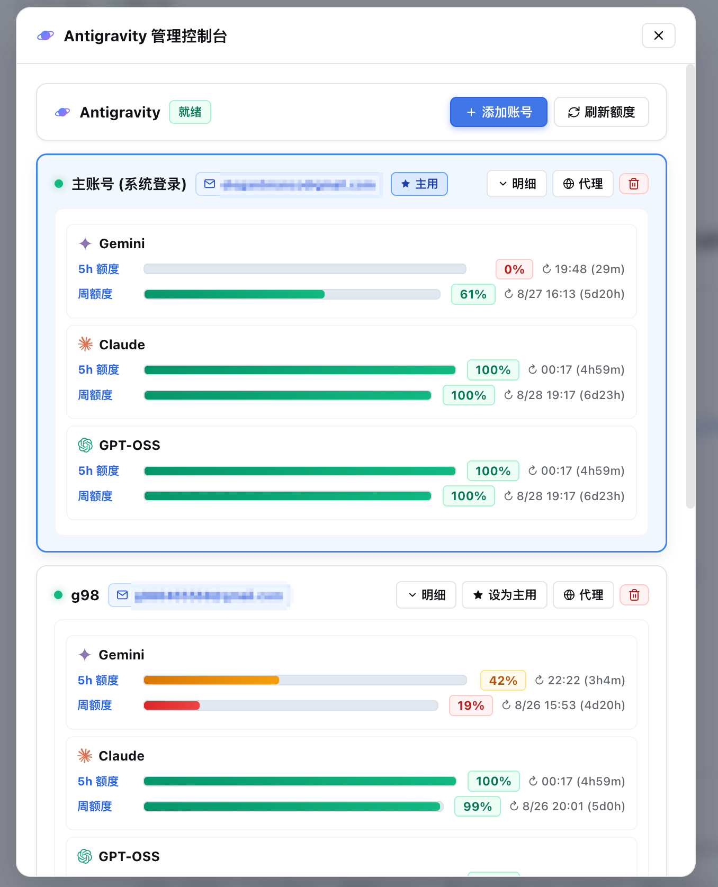
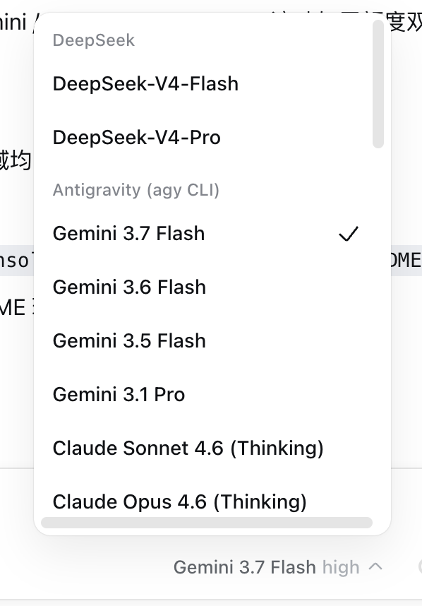

<h1 align="center">🛰️ dsh-agy-link</h1>

<p align="center">
  <b>DeepSeek Harness × Google Antigravity</b> — 多账号智能池化与官方 agy CLI 驱动桥接 / Multi-Account Pool & Native agy CLI Bridge for DSH
</p>

<p align="center">
  <a href="https://www.npmjs.com/package/dsh-agy-link"></a>
  <a href="https://github.com/amlyczz/dsh-agy-link/actions/workflows/ci.yml"></a>
  
  
</p>

<p align="center">
  <b>🌐 Language / 语言：</b>
  <a href="#中文">中文</a> ·
  <a href="#english">English</a> ·
  <a href="./docs/README.pt-BR.md">Português (Brasil)</a> ·
  <a href="./docs/README.es.md">Español</a> ·
  <a href="./docs/README.en.md">English (standalone)</a>
</p>

---

# 中文

把 **Google Antigravity 模型接入 DeepSeek Harness（DSH）** —— 支持**多账号智能池化轮换**、**官方多 Bucket 配额监控（5小时滚动 + 7天周额度 + Argon 独立周池）**、**浏览器免粘贴一键登录**与**浅色/深色主题高对比度自适应**，由官方未修改的 `agy` CLI 驱动，完整支持流式输出、思考折叠（thinking）、原生工具卡片与精确 token 用量。

<p align="center">
  
  &nbsp;&nbsp;
  
</p>
<p align="center">
  
  &nbsp;&nbsp;
  
</p>

---

> 🚨 **【国内用户核心前置：必须开启系统代理 / TUN 模式！】**
>
> Google Antigravity 服务及 OAuth 登录需要直连 Google 海外官方服务器（`oauth2.googleapis.com`、`cloudcode-pa.googleapis.com` 等）。
>
> 1. **推荐方式（最稳妥）**：开启代理工具（Clash / Surge / v2rayA / Sing-box / Loon 等）的 **TUN 虚拟网卡模式（或系统代理全局接管）**，确保终端命令、后台 Node.js 进程及浏览器均能顺畅访问 Google 网络。
> 2. **终端代理环境变量**：若终端未被代理自动接管，启动 DSH 或运行命令前请在终端中执行：
>    ```bash
>    export HTTPS_PROXY=http://127.0.0.1:7890 HTTP_PROXY=http://127.0.0.1:7890 ALL_PROXY=socks5://127.0.0.1:7890
>    ```
>    *(注：端口 `7890` 请替换为你本地代理软件的实际端口)*
> 3. **GUI 单账号独立代理**：进入 DSH「设置 → Antigravity」或点击顶部 `AGY` 徽标，点击卡片上的「🌐 代理」按钮，可为特定账号单独配置专属代理 URL（如 `http://127.0.0.1:7890`），实现多账号不同 IP 出口隔离。

---

## 🌟 核心亮点：多账号池化与智能轮换

你拥有多个 Google Antigravity / Gemini 账号？**dsh-agy-link 让多账号管理变得极致简单与自动化**：

- 👥 **多账号池化管理 (Account Pool)**：在 DSH 内添加任意数量的 Google 账号（主账号 + 备用账号群），每个账号拥有独立的 HOME 目录沙箱与凭证隔离。
- 🔄 **顺序耗尽故障转移 (Sequential Drain)**：当前账号额度用尽（触发 429 限流或 5h / 周额度耗尽）时，系统**自动平滑接力至下一个可用账号**，对话完全不中断！
- 🕰 **额度到期优先轮换 (Quota-Expiry-First)**：多个账号可用时，优先切换到**重置窗口最早到期**的账号，把"还剩很久才重置"的额度留给后面，整体池化利用率最大化。
- 🧠 **网络抖动智能甄别 (Jitter-Safe Auth)**：代理抖动导致的 keyring 鉴权超时会被自动识别为**可重试的网络错误**而非"登录失效"——基于 agy 本次运行日志的 `keyringAuth` 传输证据精准分类，且粘性"需重新登录"隔离需二次确认，健康账号绝不会被误标。
- 📊 **官方多 Bucket 配额监控 (Multi-Bucket Quota)**：直接调用 Antigravity 官方专用的 `v1internal:retrieveUserQuotaSummary` 接口，同时展示 **5小时滚动额度**、**7天周额度**，以及付费 Pro/Ultra 账号专属的 **Gemini 4 Argon 独立周额度池**（不占用普通 Gemini 池）。
- 🔀 **手动切换当前账号 (Manual Switch-Active)**：控制台卡片一键「设为当前使用」，即刻把调度指针钉到指定账号。
- 🔑 **GUI 内浏览器免粘贴登录 (In-GUI Zero-Paste OAuth)**：点击「➕ 添加账号」自动调起系统浏览器，本地回环监听自动捕获授权凭证，**全程无需手动复制粘贴授权码**。
- 🎨 **多主题高对比度自适应 (Light & Dark Themes)**：原生适配 DSH 浅色/深色主题，告别发暗发灰与看不清文字，UI 视觉清晰锐利。
- 🌐 **独立账号网络代理 (Per-Account Proxy)**：支持为每个账号独立绑定 HTTP(S) / SOCKS 代理，避免多账号同 IP 引起风控；未显式配置时自动探测系统代理（macOS `scutil` / Windows 注册表 / Linux gsettings）。
- ⚡ **分模型族独立冷却 (Family-Scoped Cooldown)**：Gemini、Claude、GPT-OSS 与 Argon 的速率限制独立计算，某个模型族受限不影响其他模型族正常调用。

---

## ✨ 全功能特性一览

| 能力 | 说明 |
| ---- | ---- |
| 🎨 **官方专属矢量 Logo** | 36×36 高质感纯矢量微标（`assets/icon.svg`），透明底自适应深浅主题；设置左侧导航菜单（`[role="dialog"] nav`）动态替换系统齿轮，呈现专属品牌标识 |
| 🧩 **设置与插件面板统一** | 在 DSH「设置 → 插件」详情页直接内嵌 Antigravity 完整控制台，账号池、配额监控与代理配置一站式操作，列表保持轻量整洁 |
| 🚀 **副账号并发租约** | Windows 凭据槽支持同一副账号多会话共享租约并发运行，消除单账号多任务排队饥饿；仅在跨账号身份切换时串行交接 |
| ⚡ **原生上下文缓存与真实计量** | 完整映射 Google Gemini 原生上下文缓存协议（`cache_read_tokens`），精准追踪缓存读取与物理上下文占用，深度适配 1M 超长上下文 |
| 👥 **多账号池化轮换** | 支持主账号 + 多个备用账号；遇到 429 或配额耗尽自动平滑切换，模型族独立冷却，额度到期早的账号优先接班 |
| 🧠 **抖动安全鉴权 (Jitter-Safe Auth)** | 基于 agy 运行日志的 keyring 传输证据区分"网络抖动"与"真登出"，抖动自动按可重试网络错误处理；粘性隔离需二次确认，杜绝误标"需重新登录" |
| 📊 **官方多 Bucket 配额监控** | 实时拉取官方端点，同时呈现 **5h 滚动额度**、**7d 周额度**与 **Argon 独立周池**（付费 Pro/Ultra）多进度条与倒计时，单模型明细可展开 |
| 🔑 **浏览器一键登录** | 点击添加账号自动唤起 Google 授权页，本地回环自动捕获，全程无需复制粘贴任何代码 |
| 🔀 **手动切换当前账号** | 控制台「设为当前使用」按钮即刻钉住调度指针；顶部徽标始终显示服务器实际调度的账号 |
| 🎨 **多主题高对比 UI** | 浅色、深色主题自适应变色，纯矢量 SVG 图标（无 Emoji），字迹清晰不发暗 |
| 🌐 **独立账号代理** | 每个账号支持独立配置 HTTP(S) 代理，隔离 IP 出口；亦可自动探测系统代理 |
| 🔌 **原生模型路由** | 在 DSH 模型配置中注册 `antigravity` 提供方，`/model` 选择器随心切换 Gemini / Claude / GPT-OSS / Argon |
| 🌊 **完整流式映射** | 文本、思考过程（thinking turn）与工具活动均无损映射到 DSH 原生流协议 |
| 🃏 **原生工具卡片** | agy 执行的终端命令（`run_command`）、文件修改（inline diff）均以 DSH 原生卡片渲染 |
| 🔗 **会话上下文保真** | DSH 会话与 agy 原生会话绑定（`--conversation`），由 agy 管理完整历史，每轮仅发送增量 |
| 🎯 **DSH 目标与计划集成** | 长任务自动携带 DSH goal / plan 上下文，工具续跑不丢任务状态 |
| 📊 **精确 Token 统计** | 输入 / 输出 / 思考 / 缓存读取 token 完整计入 DSH 用量统计，全面适配 1M 上下文 |
| 🎛 **顶部控制台徽标** | 顶部栏 `AGY (n)` 徽标一键弹出控制台，直观查看账号池、配额进度条与代理状态 |
| 🖼 **图片多模态** | 支持多模态图片传入，自动落盘本地媒体目录并通过 `--add-dir` 安全授权给 agy 查看 |
| 🤝 **`agy_ask` 辅助工具** | 允许任意 DSH 模型把单次任务委托给 Antigravity 模型（AskAntigravity 协作模式） |
| ⌨️ **`/agy` 快捷命令族** | `status` / `pool` / `auth` / `models` / `mode` / `effort` / `workspace` / `goal` / `session` / `enable-account` / `disable-account` / `clear` / `doctor` / `help` |
---

## 📋 前置要求

在安装本插件前，请确保具备以下环境：

| 前置项 | 说明 / 验证方式 |
| --- | --- |
| **1. 系统网络代理** | **【必须开启】**（推荐开启 Clash / Surge / v2rayA 的 TUN 模式或设置 `HTTPS_PROXY` 环境变量，确保可流畅连接 Google 服务） |
| **2. DeepSeek Harness (DSH)** | 你正在使用的 DSH 客户端；`dsh --version` 可验证 |
| **3. Node.js ≥ 24** | DSH 依赖环境；`node --version` 验证 |
| **4. Google Antigravity `agy` CLI** | 按 [Google 官方安装文档](https://antigravity.google/docs/cli/install) 安装（支持 macOS / Linux / Windows）。`agy --version` 能输出版本号即表示安装成功 |

> 💡 **提示**：即使你的 agy 尚未登录，也可以直接安装插件！在 DSH 界面顶部点击 `AGY` 徽标或进入「设置 → Antigravity」，点击「➕ 添加账号」即可直接在浏览器中完成登录。

---

## 🚀 快速上手

```bash
# 0. 确保系统代理 / TUN 模式已开启（国内网络必需）：
export HTTPS_PROXY=http://127.0.0.1:7890 HTTP_PROXY=http://127.0.0.1:7890

# 1. 安装插件（npm 官方包，无需编译构建）：
dsh plugin --profile web add dsh-agy-link

# 升级到最新版：
# dsh plugin --profile web add dsh-agy-link@latest --registry https://registry.npmjs.org

# 2. 启动 DSH Web GUI，在输入框中检查状态：
#   /agy status

# 3. 登录与添加账号：
#   方式 A：点击顶部导航栏的 "AGY (n)" 徽标，点击 "➕ 添加账号"，浏览器一键登录；
#   方式 B：输入框执行 /agy auth 为主账号发起登录。

# 4. 在 /model 选择器中挑选 Antigravity 模型，立即开启对话！
```

---

## ⚙️ 配置说明

插件配置可在 `/plugin`、设置面板或环境变量中灵活调整：

| 键名 | 环境变量 | 默认值 | 作用说明 |
| --- | --- | --- | --- |
| `enabled` | `DSH_AGY_ENABLED` | `true` | 插件主开关 |
| `agyBin` | `DSH_AGY_BIN` | 自动探测 | 显式指定 `agy` 二进制路径 |
| `permissionMode` | `DSH_AGY_MODE` | `skip` | 权限模式：`skip`（无人值守执行）/ `plan` / `accept-edits` |
| `defaultModel` | `DSH_AGY_DEFAULT_MODEL` | `(agy 默认)` | 默认模型 slug |
| `defaultEffort` | `DSH_AGY_DEFAULT_EFFORT` | `(模型默认)` | 思考预算：`low` / `medium` / `high` |
| `hiddenModels` | `DSH_AGY_HIDDEN_MODELS` | `[]` | 在 `/model` 选择器中隐藏的模型 slug 列表（黑名单语义，新模型默认可见；建议直接在设置面板"模型显示"中点选管理） |
| `timeoutMs` | `DSH_AGY_TIMEOUT_MS` | `600000` | 单轮活跃看门狗超时（毫秒） |
| `longToolIdleMinutes` | `DSH_AGY_LONG_TOOL_IDLE_MINUTES` | `240` | 存在未完成工具步骤（ACTIVE）时的空闲预算（分钟）；`0` = 不抬高预算，卡死的工具按 `timeoutMs` 快速失败 |
| `workspaceRoot` | `DSH_AGY_WORKSPACE_ROOT` | 会话 cwd | agy 工作区根目录（默认跟随当前会话工作区） |
| `suppressAgyAutoUpdate` | `DSH_AGY_SUPPRESS_AUTOUPDATE` | Windows `true`，其他平台 `false` | 每次 spawn 前刷新 agy 的更新检查时间戳，阻断 `--bg-updater` 子进程链（Windows 闪窗根因）。关闭后 agy 恢复自动更新检查 |
| `autoWarmup` | `DSH_AGY_AUTO_WARMUP` | `false` | 7 天周配额自动预热（opt-in）：周额度到达重置时间或冷启动时发送极小探活请求，提前激活 7 天计时器。开启后每 5 分钟巡检一次；该路径直连 Google 内部端点，请自行评估风控风险 |
| `warmupModels` | `DSH_AGY_WARMUP_MODELS` | `gemini-3.8-flash,claude-sonnet-4-6` | 自动预热使用的模型列表（逗号分隔）；空数组表示不自动预热 |

---

## 🧩 架构与工作原理

1. **短生命周期进程驱动**：每一轮 DSH 对话启动一个独立的官方 `agy -p --output-format stream-json` 进程，解析 NDJSON 事件流。
2. **多账号沙箱机制**：除主账号沿用系统默认 Keychain / HOME 外，所有备用账号在插件私有目录下建立专属 HOME 隔离区，独立写入 agy 格式的标准 OAuth 凭证。Windows 上 agy 的凭据实际存放在机器级 Credential Manager（`gemini:antigravity`），插件因此以「身份级引用计数租约」接管该槽：**同一授权的多个会话并行运行**，只有账号**身份切换**才串行，且由最后一个持有者还原主账号凭据。
3. **多 Bucket 官方配额汇总**：插件定时后台静默轮询官方 `v1internal:retrieveUserQuotaSummary`，精准掌控每个账号的 5h 滚动削峰水位、7d 账号阶梯周额度，以及付费账号的 Argon 独立周池。
4. **会话级无缝故障转移**：当遭遇 HTTP 429、额度耗尽或凭证异常时，号池调度器自动标记当前账号家族进入冷却（或按额度到期时间择优轮换），并无缝将后续请求路由到池内下一个有效账号。
5. **失败分类与自愈**：错误按 AUTH / NETWORK / RATE_LIMIT / ELIGIBILITY 等精确分类；网络抖动借由 agy 运行日志自动甄别为可重试故障，绝不误伤健康账号的登录状态。

---

## ❓ 常见问题排查 (FAQ)

### Windows 平台开始对话时为什么会短暂闪一下黑色命令行窗口（黑框）？
**答：这是 Windows 系统的控制台分配机制，完全良性，不会影响对话和模型功能。**
- **原因分析**：DSH 是基于 Electron 的图形桌面应用（GUI 进程），每次发起对话时，插件需要调用底层命令校验并同步当前账号在 Windows 凭据管理器（Credential Manager）中的 OAuth Token，随后启动 `agy.exe` 控制台子进程建立流式通信。在 Windows 11 下，系统默认终端若被设为「Windows 终端 (Windows Terminal)」，Windows Terminal 会拦截后台控制台子进程的句柄分配并闪现弹窗（这是 Windows Terminal 已知的 OpenConsole 委托拦截机制）。
- **解决步骤**：
  1. 打开 **Windows 终端 (Windows Terminal)** 的「设置」→「启动」（或进入 Windows「设置」→「系统」→「开发者选项」）。
  2. 将 **默认终端应用程序 (Default terminal application)** 从「让 Windows 决定」或「Windows 终端」更改为 **「Windows 控制台主机 (Windows Console Host)」**。
  3. 点击右下角 **保存 (Save)**。
  4. **完全退出并重启 DSH**（使新启动的主进程应用更新后的控制台委托注册表），黑框闪烁即可彻底消除。

### agy 自己的自动更新子进程也会闪窗（0.4.66 修复）
除了上面那种控制台委托导致的闪窗，`agy` **自己**还会在距上次更新检查满 15 分钟后派生一条 `--bg-updater` → `agy --version` 的子进程链，**这条链由 agy 内部创建，会自行分配可见控制台**，父进程的 `windowsHide` 和 `AGY_CLI_DISABLE_AUTO_UPDATE=1` 都来不及生效（这就是 Issue #49 实测确认的结论）。

0.4.66 起的处理方式：每次 spawn agy 之前，插件把 agy 更新检查的 fast-path 时间戳（`<agy home>/last_check.timestamp`）刷新为当前时间。agy 的检查逻辑是「距上次检查 < 15 分钟就直接跳过且不派生子进程」，于是这条可见窗口链根本不会被创建——对话、冷启动探测、模型选择器刷新、登录探测全部覆盖。

- **代价**：插件所使用的那个 agy home 不再自动检查更新；手动 `agy update` 完全不受影响。
- **开关**：`suppressAgyAutoUpdate`（环境变量 `DSH_AGY_SUPPRESS_AUTOUPDATE`）。Windows 上默认开启，其他平台默认关闭；设为 `false` 即回到 agy 原本的自动更新行为。
- **旧版本用户的手动 workaround**：把 `%USERPROFILE%\.gemini\antigravity-cli\updater\update.lock` 设为只读（`attrib +R ...`），agy 拿不到更新锁就会跳过检查。代价是手动 `agy update` 会报 `update already in progress`，需要先 `attrib -R`。


---

## 🙏 参考与致谢

- [CLIProxyAPI](https://github.com/router-for-me/CLIProxyAPI) — Antigravity 公开 OAuth 客户端与回环回调登录范式
- [opencode-antigravity-auth](https://github.com/NoeFabris/opencode-antigravity-auth) — opencode 平台的多账号实践
- [OmniRoute](https://github.com/diegosouzapw/OmniRoute) — Antigravity 端点分发与配额语义
- [pi-mono](https://github.com/badlogic/pi-mono) — Antigravity 轮换与桥接设计参考

---

## ⚠️ 免责声明

本插件仅通过调用用户本地官方安装的未修改 `agy` CLI 进程进行交互。使用本插件需遵循 Google Antigravity 服务条款。

## 许可证

MIT License.

---

# English

Bring **Google Antigravity models into DeepSeek Harness (DSH)** — featuring **Multi-Account Pooling & Automatic Rotation**, **Official Multi-Bucket Quota Tracking (5h Rolling + 7d Weekly + Argon Weekly Pool)**, **Zero-Paste In-GUI OAuth Login**, and **Theme-Adaptive High-Contrast UI**, powered by the official unmodified `agy` CLI.

<p align="center">
  
  &nbsp;&nbsp;
  
</p>
<p align="center">
  
  &nbsp;&nbsp;
  
</p>

---

> 🚨 **【Important: System Proxy / VPN / TUN Mode Required in Restricted Regions】**
>
> Google Antigravity services and Google OAuth require access to Google servers (`oauth2.googleapis.com`, `cloudcode-pa.googleapis.com`, etc.).
>
> 1. **Recommended**: Enable **TUN mode / System Proxy** in your VPN or proxy client (Clash, Surge, Sing-box, etc.) so that all terminal commands, Node.js background processes, and browser calls route through your proxy.
> 2. **Terminal Proxy Export**: If your terminal does not inherit proxy automatically, export the environment variables before starting DSH:
>    ```bash
>    export HTTPS_PROXY=http://127.0.0.1:7890 HTTP_PROXY=http://127.0.0.1:7890 ALL_PROXY=socks5://127.0.0.1:7890
>    ```
> 3. **Per-Account Dedicated Proxy**: You can also configure a dedicated proxy URL per account directly in DSH Settings → Antigravity by clicking the "🌐 Proxy" button on the account card (e.g. `http://127.0.0.1:7890`).

---

## 🌟 Core Feature: Multi-Account Pool & Smart Rotation

Have multiple Google Antigravity / Gemini accounts? **dsh-agy-link makes multi-account orchestration seamless and automated**:

- 👥 **Multi-Account Pooling**: Manage unlimited Google accounts (Primary + Secondary pool) with fully isolated HOME sandbox environments and credentials.
- 🔄 **Sequential Drain Failover**: When an account reaches its rate limits (429) or runs out of 5h/weekly quotas, requests **automatically and smoothly fail over to the next available account** without interrupting your conversation!
- 🕰 **Quota-Expiry-First Rotation**: With several accounts available, the scheduler prefers the one whose **reset window expires soonest**, maximizing utilization across the whole pool.
- 🧠 **Jitter-Safe Auth Classification**: A keyring-auth timeout caused by proxy jitter is recognized as a **retryable network error**, not a sign-out — classified from the `keyringAuth` transport evidence in agy's own run log, and sticky "needs re-login" quarantine requires a second confirmation, so healthy accounts are never falsely flagged.
- 📊 **Official Multi-Bucket Quota Tracking**: Direct integration with Antigravity's official `v1internal:retrieveUserQuotaSummary` endpoint, providing real-time visibility for the **5-Hour Rolling Limit**, the **7-Day Weekly Limit**, and the **Gemini 4 Argon weekly pool** (paid Pro/Ultra accounts, billed separately from the plain Gemini pool).
- 🔀 **Manual Switch-Active**: One click on "Set active" pins the scheduler pointer to the account you choose.
- 🔑 **In-GUI Zero-Paste OAuth**: One-click "Add Account" opens your browser and automatically captures OAuth tokens via local loopback — **no copying and pasting of authorization codes required**.
- 🎨 **Theme-Adaptive High-Contrast UI**: Seamlessly adapts to Light and Dark DSH themes with crystal clear typography and crisp contrast.
- 🌐 **Per-Account Proxy**: Configure dedicated HTTP(S) / SOCKS proxy for each individual account to isolate IP addresses; when unset, the system proxy is auto-detected (macOS `scutil` / Windows registry / Linux gsettings).
- ⚡ **Family-Scoped Cooldowns**: Gemini, Claude, GPT-OSS, and Argon rate limits are calculated independently, preventing one exhausted model from blocking others.

---

## ✨ Features Overview

| Feature | Description |
| --- | --- |
| 🎨 **Official Vector Logo** | Clean 36×36 retina vector mark (`assets/icon.svg`) with transparent background; dynamically replaces fallback gear in DSH Settings sidebar (`[role="dialog"] nav`) |
| 🧩 **Unified Settings & Plugin Console** | Embedded Antigravity console directly in DSH Plugins settings; configure account pool, quotas, and proxies in one place while keeping list cards clean |
| 🚀 **Secondary Account Parallel Leases** | Windows credential slot allows concurrent sessions on the same account to share leases without queue starvation; serializes only for cross-account switches |
| ⚡ **Native Context Caching & Token Metering** | Native Google Gemini Prompt Caching (`cache_read_tokens`) forwarding; accurate cache read tracking and real prompt occupancy across 1M context windows |
| 👥 **Multi-Account Pool** | Primary + unlimited spare accounts with automatic Sequential Drain rotation upon rate limits; quota-expiry-first scheduling |
| 🧠 **Jitter-Safe Auth** | Distinguishes network jitter from a real sign-out via keyring transport evidence in agy's run log; sticky quarantine requires confirmation — no false "needs re-login" flags |
| 📊 **Multi-Bucket Quota HUD** | Real-time progress bars for the **5h rolling**, **7d weekly**, and **Argon weekly** (paid Pro/Ultra) pools with exact reset countdowns |
| 🔑 **Zero-Paste Browser Login** | Automatic browser-based Google OAuth login with loopback callback handler |
| 🔀 **Manual Switch-Active** | Pin the scheduler to any account from the console; the header badge always names the server-scheduled account |
| 🎨 **Theme-Adaptive UI** | Dynamic light/dark theme switching, pure SVG vector marks (no emojis), high contrast |
| 🌐 **Per-Account Proxy** | Dedicated HTTP(S) proxy per account slot, or auto-detected system proxy |
| 🔌 **Native Model Routing** | Registers `antigravity` provider in DSH; choose Gemini / Claude / GPT-OSS / Argon in `/model` picker |
| 🌊 **Full Streaming Protocol** | Native streaming for text, thinking turn annotations, and tool calls |
| 🃏 **Native Tool UI Cards** | Command runs and inline diffs render as clean, native DSH tool cards |
| 🔗 **Session Continuity** | Binds DSH sessions to native agy conversations (`--conversation`) for zero-redundancy context |
| 🎯 **DSH Goal & Plan Integration** | Long-running tasks carry DSH goal / plan context across tool continuations |
| 📊 **Accurate Token Metering** | Input, output, thinking, and cacheRead tokens are fully reported to DSH with 1M context support |
| 🎛 **Top Header Console Badge** | Click the `AGY (n)` badge in the header to instantly open the management console |
| 🖼 **Multimodal Images** | Stages images to local storage and passes safe absolute paths via `--add-dir` |
| 🤝 **`agy_ask` Delegation** | Allows other DSH models to delegate subtasks to Antigravity models |
| ⌨️ **`/agy` Commands** | Full command suite: `status`, `pool`, `auth`, `models`, `mode`, `effort`, `workspace`, `goal`, `session`, `enable-account`, `disable-account`, `clear`, `doctor`, `help` |

---

## 📋 Prerequisites

| Requirement | Details |
| --- | --- |
| **1. System Proxy / VPN** | **【Required in restricted regions】** (TUN mode or `HTTPS_PROXY` environment variable to ensure Google endpoints are reachable) |
| **2. DeepSeek Harness (DSH)** | Your current DSH environment (`dsh --version`) |
| **3. Node.js ≥ 24** | Required runtime (`node --version`) |
| **4. Google Antigravity `agy` CLI** | Installed per [Google's official guide](https://antigravity.google/docs/cli/install). Verified with `agy --version` |

---

## 🚀 Quick Start

```bash
# 0. Ensure System Proxy / TUN mode is active (required for Google connectivity):
export HTTPS_PROXY=http://127.0.0.1:7890 HTTP_PROXY=http://127.0.0.1:7890

# 1. Install plugin:
dsh plugin --profile web add dsh-agy-link

# Upgrade to latest:
# dsh plugin --profile web add dsh-agy-link@latest --registry https://registry.npmjs.org

# 2. Start DSH Web GUI, test status:
#   /agy status

# 3. Add accounts:
#   Click "AGY (n)" badge in the top header, click "➕ Add Account" and complete browser login.

# 4. Select an Antigravity model in /model and start chatting!
```

---

## ⚙️ Configuration

| Key | Environment Variable | Default | Description |
| --- | --- | --- | --- |
| `enabled` | `DSH_AGY_ENABLED` | `true` | Master switch |
| `agyBin` | `DSH_AGY_BIN` | auto-detected | Path to `agy` binary |
| `permissionMode` | `DSH_AGY_MODE` | `skip` | `skip` (unattended execution) / `plan` / `accept-edits` |
| `defaultModel` | `DSH_AGY_DEFAULT_MODEL` | `(agy default)` | Default model slug |
| `defaultEffort` | `DSH_AGY_DEFAULT_EFFORT` | `(model default)` | Thinking budget: `low` / `medium` / `high` |
| `hiddenModels` | `DSH_AGY_HIDDEN_MODELS` | `[]` | Model slugs hidden from the `/model` picker (deny-list, newly discovered models stay visible; manage them via the "Model visibility" row in the settings panel) |
| `timeoutMs` | `DSH_AGY_TIMEOUT_MS` | `600000` | Activity watchdog timeout in milliseconds |
| `longToolIdleMinutes` | `DSH_AGY_LONG_TOOL_IDLE_MINUTES` | `240` | Idle budget while a tool step is ACTIVE (minutes); `0` keeps the normal `timeoutMs` budget so wedged tools fail fast |
| `workspaceRoot` | `DSH_AGY_WORKSPACE_ROOT` | session cwd | Working directory root |
| `suppressAgyAutoUpdate` | `DSH_AGY_SUPPRESS_AUTOUPDATE` | `true` on Windows, `false` elsewhere | Refreshes agy's update-check timestamp before every spawn so its `--bg-updater` child chain (the Windows console-flash root cause) never starts. `false` restores agy's own auto-update checks |
| `autoWarmup` | `DSH_AGY_AUTO_WARMUP` | `false` | Opt-in 7-day weekly quota warmup: sends a minimal probe when the weekly window has reset or is cold, activating the 7-day timer. Scans every 5 minutes; this path talks directly to Google's internal endpoints, so assess the risk-control tradeoff yourself |
| `warmupModels` | `DSH_AGY_WARMUP_MODELS` | `gemini-3.8-flash,claude-sonnet-4-6` | Model list used for warmup probes (comma-separated); an empty list disables automatic warmup |

---

## Headless operation

See [Headless permissions](docs/HEADLESS-PERMISSIONS.md) for a bounded reproduction,
least-privilege read-rule validation, and process-versus-tool acceptance checks.

The plugin passes the selected permission mode to `agy`; it does not approve,
deny, or bypass permissions itself. In headless/print operation, `agy` can
automatically deny a tool request in `plan` or `accept-edits`. The raw tool
error is retained in `/agy status`; it is not proof of a human denial.

Do not assume undocumented wildcard semantics for either mode. Test the exact
`agy` version and command set in a scoped workspace. Choose `skip` only when
you explicitly accept unattended tool execution.

---

## ❓ FAQ & Troubleshooting

### Why does a black command prompt / terminal window briefly flash when starting a conversation on Windows?
**A: This is a cosmetic behavior of the Windows Console subsystem and is completely harmless.**
- **Root Cause**: DSH is an Electron desktop app (GUI process). Before each conversation turn, the plugin verifies/syncs Google credentials via the Windows Credential Manager and launches the `agy.exe` console child process for streaming. On Windows 11, if the system default terminal is set to "Windows Terminal", Windows Terminal intercepts the background console allocation and momentarily flashes an empty window (a known Windows Terminal OpenConsole delegation behavior).
- **Solution**:
  1. Open **Windows Terminal** → **Settings** → **Startup** (or Windows **Settings** → **System** → **For developers**).
  2. Change **Default terminal application** from "Let Windows decide" or "Windows Terminal" to **"Windows Console Host"**.
  3. Click **Save** in the bottom-right corner.
  4. **Completely exit and restart DSH** so the running host process picks up the updated console delegation setting.

### agy's own auto-updater also flashes a window (fixed in 0.4.66)
On top of the console-delegation flash above, `agy` itself spawns a
`--bg-updater` → `agy --version` child chain once its last update check is more
than 15 minutes old. **That chain is created inside agy and allocates its own
visible console**, so the parent's `windowsHide` and `AGY_CLI_DISABLE_AUTO_UPDATE=1`
both apply too late — the exact conclusion of the measurements recorded in issue #49.

Since 0.4.66 the plugin refreshes agy's fast-path timestamp
(`<agy home>/last_check.timestamp`) right before every spawn. agy skips the
check entirely when it is under 15 minutes old and spawns nothing, so the
visible window chain never starts — for turns, boot probes, model-picker
refreshes and login probes alike.

- **Cost**: the agy home used by this plugin stops auto-checking for updates;
  a manual `agy update` still works normally.
- **Switch**: `suppressAgyAutoUpdate` (env `DSH_AGY_SUPPRESS_AUTOUPDATE`).
  On by default on Windows, off elsewhere; set `false` to restore agy's own behaviour.
- **Manual workaround on older versions**: make
  `%USERPROFILE%\.gemini\antigravity-cli\updater\update.lock` read-only
  (`attrib +R ...`). agy then fails to acquire the update lock and skips the
  check — at the price of `agy update` reporting `update already in progress`
  until you run `attrib -R`.

---

## ⚠️ Disclaimer

This plugin operates strictly by invoking the official, unmodified `agy` CLI binary installed on your local system. Use of this plugin is subject to Google Antigravity's Terms of Service.

## License

MIT License.
