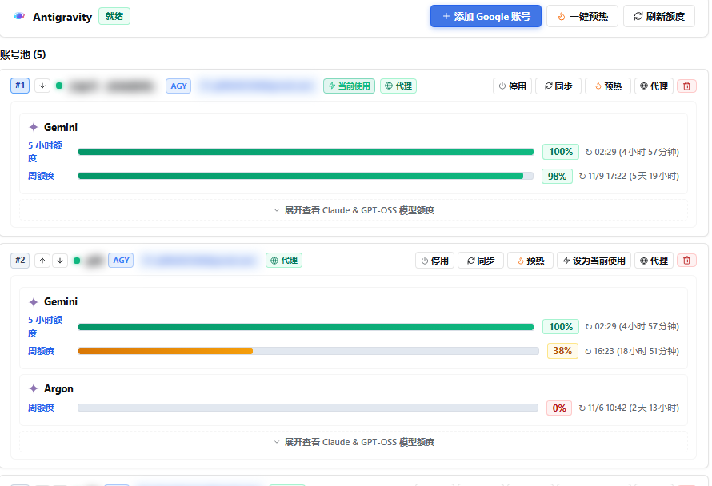
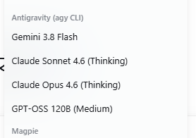
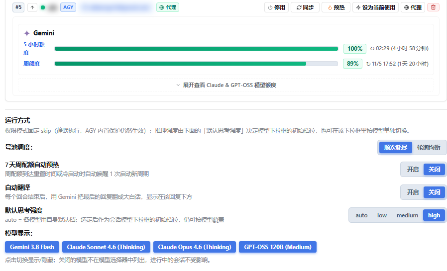

# dsh-agy-link — English

Bring Google Antigravity into DeepSeek Harness (DSH). The plugin drives the official, unmodified `agy` CLI and adds multi-account pooling, official multi-bucket quota tracking, native streaming and tool cards, and `/tsl` plain-language rewriting.

<p align="center">
  
</p>

<p align="center">
  
  &nbsp;&nbsp;
  
</p>

## Overview

Each turn spawns the official `agy` process, parses its NDJSON event stream and maps it to native DSH text, thinking, tool cards and token accounting. Account rotation, quota inspection and retries happen inside the plugin; DSH only sees a normal model call.

- Multiple Google accounts drain in order, so a conversation survives a quota wall.
- Quotas come from the official endpoint: 5-hour window, weekly window and the paid Argon pool are reported separately.
- Thinking, terminal commands and file edits render as native DSH cards.
- `/tsl` rewrites any reply in plain language when a model writes too formally.

## Requirements

| Requirement | Verification |
| --- | --- |
| DSH | `dsh --version` |
| Node.js ≥ 24 | `node --version` |
| Google Antigravity CLI | `agy --version` |
| Google connectivity | proxy / VPN / TUN where required |

Where Google is not directly reachable, enable system proxy or TUN mode. If the terminal does not inherit the proxy, export it before starting DSH:

```bash
export HTTPS_PROXY=http://127.0.0.1:7890 HTTP_PROXY=http://127.0.0.1:7890 ALL_PROXY=socks5://127.0.0.1:7890
```

Replace the port with your local proxy port. A dedicated proxy can also be configured per account in the console.

## Install and quick start

```bash
dsh plugin --profile web add dsh-agy-link
dsh web
```

In DSH, click the `AGY (n)` badge and choose "Add account" to complete Google login in the browser; no authorization code needs copying. Alternatively run `/agy auth` for the primary account. Then pick an Antigravity model in `/model` and start chatting. `/agy status` reports the current state.

## Core features

- **Account pool**: isolated HOME and OAuth credentials per account; sequential drain on 429 or exhaustion; quota-expiry-first rotation; family-scoped cooldowns; manual switch; per-account proxy; parallel credential leases.
- **Official quotas**: 5-hour rolling, 7-day weekly and the Argon weekly pool, each with reset countdowns and per-model detail.
- **Console and settings**: the `AGY (n)` header badge and Settings → Plugins → Antigravity open the same console. Inside: the account card (proxy, enable, warmup, delete), a runtime note (permission fixed to `skip`), pool scheduling (sequential drain / round robin), 7-day auto-warmup, auto translate, default thinking effort and model visibility toggles. The picker lists models under `Antigravity (agy CLI)`: Gemini 3.8 Flash, Claude Sonnet 4.6 (Thinking), Claude Opus 4.6 (Thinking), GPT-OSS 120B (Medium).
- **Native integration**: `antigravity` provider in `/model` with the Gemini, Claude, GPT-OSS and Argon families; streaming text, thinking and tool activity; Terminal and diff cards, with MCP meta-tools unwrapped; mermaid diagrams; `--conversation` session continuity; goal and plan forwarding; full token metering with 1M context; multimodal images; `agy_ask` delegation.
- **Effort learning**: a model that rejects `--effort` is replayed once without the flag and remembered in `~/.dsh/agy-link/effort-unsupported.json`, so a mismatch never fails a turn.
- **`/tsl` translation**: command, opt-in auto mode and a per-reply action; results persist as a card under the reply, keep the original behind a toggle and never enter model-visible history; uses the same account pool with failover.

## `/agy` commands

`status`, `pool` / `accounts`, `auth` / `auth-code`, `add-account` / `remove-account`, `enable-account` / `disable-account`, `refresh-quota` / `clear-cooldown`, `models`, `mode`, `effort`, `dispatch` / `dispatch-retries` / `parallel` / `max-concurrent`, `workspace`, `goal`, `session`, `clear`, `doctor`.

## `/tsl` usage

```
/tsl                       # translate the last completed turn
/tsl 3                     # translate turn 3
/tsl --full                # include intermediate narration
/tsl --text 任意文本…       # translate arbitrary text (no card)
/tsl --model claude-sonnet-5-5 --effort medium
/tsl auto on|off|status    # per-session auto mode
```

## Configuration

Common keys: `enabled`, `agyBin`, `permissionMode` (default `skip`), `defaultModel`, `defaultEffort` (default `high`), `hiddenModels`, `timeoutMs`, `workspaceRoot`, `proxyUrl`, `suppressAgyAutoUpdate`, `autoWarmup`, `autoTranslate`, `translateModel`, `translateEffort`. The complete key list, environment variables and defaults are in [CONFIGURATION.md](./CONFIGURATION.md).

## Security and terms

The plugin invokes only the official, unmodified `agy` binary installed locally. Use it in accordance with Google Antigravity's Terms of Service.

## License

MIT License.
