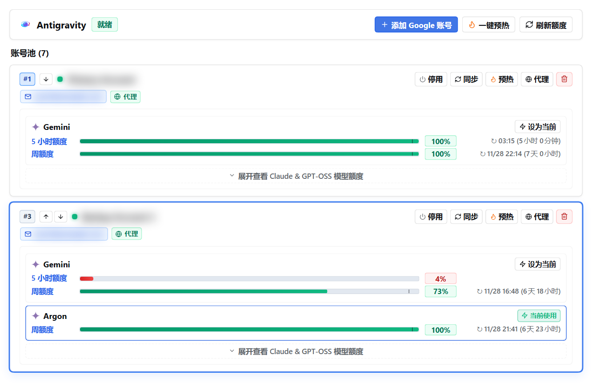
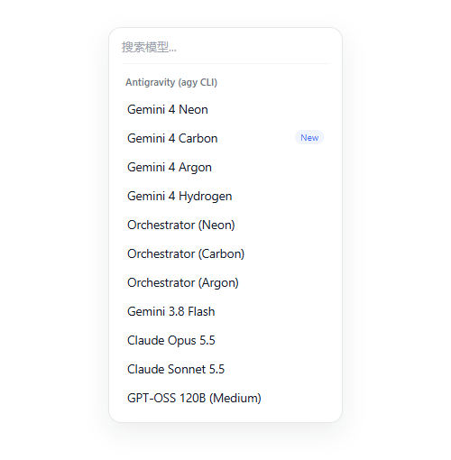
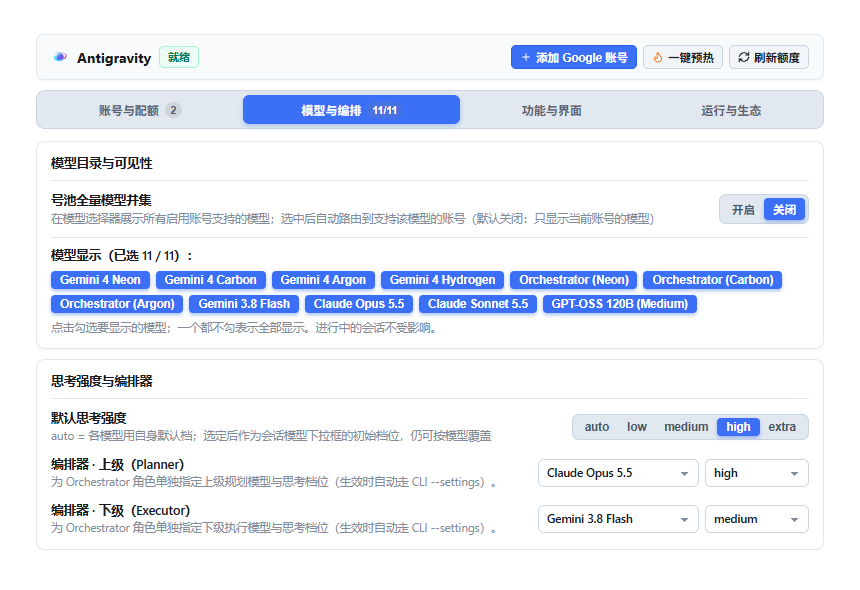
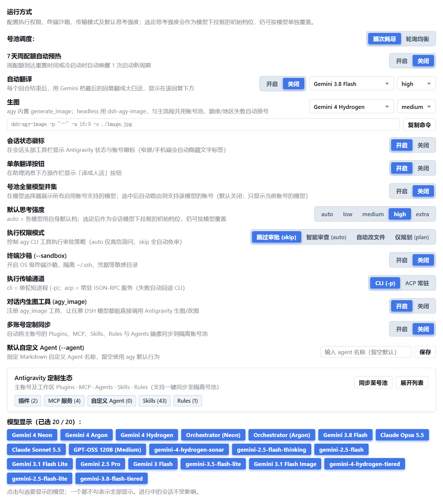
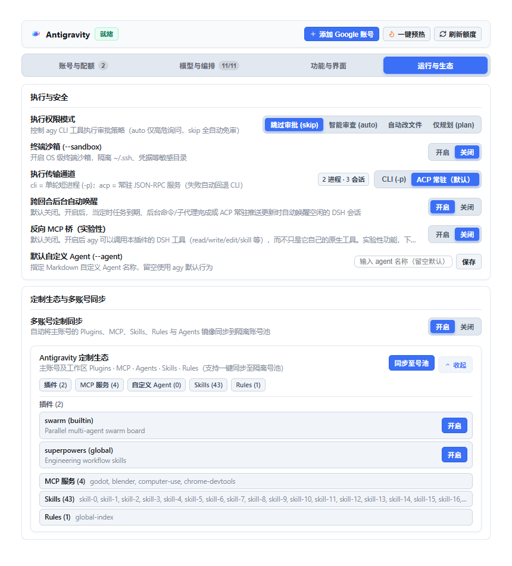
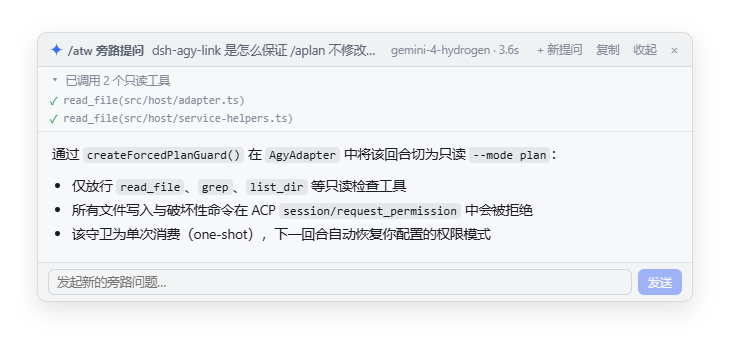
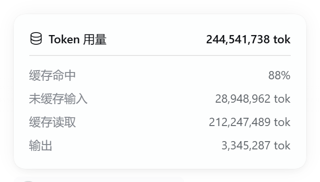
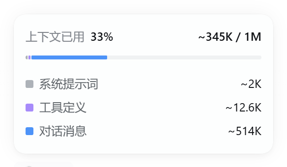

<h1 align="center">🛰️ dsh-agy-link</h1>

<p align="center">
  <b>DeepSeek Harness × Google Antigravity</b> — multi-account pooling and native <code>agy</code> CLI / ACP bridge for DSH
</p>

<p align="center">
  <a href="https://www.npmjs.com/package/dsh-agy-link"></a>
  <a href="https://github.com/amlyczz/dsh-agy-link/actions/workflows/ci.yml"></a>
  
  
  =1.5"/>
</p>

<p align="center">
  <b>🌐 Language:</b>
  <a href="../README.md">中文</a> ·
  English ·
  <a href="./CONFIGURATION.md">Configuration</a> ·
  <a href="./ARCHITECTURE.md">Architecture</a> ·
  <a href="./SECURITY-NOTES.md">Security</a>
</p>

---

Bring **Google Antigravity models into DeepSeek Harness (DSH)** through the official, unmodified `agy` CLI: streaming, thinking, rich native tool cards, Generative UI embeds, 1M physical context metering, in-GUI OAuth login, per-family multi-account pooling with automatic failover, CLI-first multi-bucket quota tracking (5h rolling + 7d weekly + Argon weekly), in-chat and CLI image generation, and multi-account ecosystem sync.

<p align="center">
  
</p>
<p align="center">
  
  &nbsp;&nbsp;
  
</p>
<p align="center">
  
  &nbsp;&nbsp;
  
</p>
<p align="center">
  
</p>
<p align="center">
  
  &nbsp;&nbsp;
  
</p>

---

## ✨ Features

| | |
| --- | --- |
| 🤖 **Antigravity models, 4-tab console & Orchestrator** | Syncs the `agy 1.5.16` lineup (including `Gemini 4 Carbon` and `Orchestrator` roles), tick-list allow-list (`selectedModels`), `poolWideCatalog` routing, `--effort` refusal learning, and Planner/Executor overrides across the 4-tab console. |
| 🔁 **Per-family multi-account pool** | Independent active pins and cooldowns across `Gemini`, `Argon`, `Claude`, and `GPT-OSS`; sequential drain or round-robin with quota-expiry-first rotation, per-account isolated HOME + proxy, and Windows identity-leased slots (#199 freshness guard). |
| 📊 **CLI-first quota console & busy deferral** | Prefers `agy -p /usage` (`quotaViaCli: true`) with official summary fallback; tracks 5h rolling, 7d weekly, and Argon weekly buckets, auto-defers background refreshes while turns are active, and drives host-backed `WarmupStatusBar`. |
| 🛡️ **4 permission modes, sandbox & ACP default** | `permissionMode` supports `skip`, `auto`, `accept-edits`, and `plan` (`/aplan` enforces one-shot read-only); defaults to persistent `agy acp` stdio pool (reused for `isAux` calls with ephemeral `session/close` and pre-stream `cli` fallback) and a session-owned route for MCP-enabled turns. |
| 🃏 **Extended tool cards & Generative UI** | Native Terminal/Diff/Read/Search/MCP cards (unwrapping `alwaysLoad` bridge names) plus dedicated cards for `swarm`, `run_workflow`, `schedule`, `manage_task`, subagent lifecycle, `image-generator`, and DevTools; renders `<agent-embed>` HTML widgets inside strict-CSP sandboxed `<iframe>`s. |
| 🎬 **Multimodal inputs & inline playback** | Stages images plus PDF, audio, and video attachments (up to `mediaMaxFileBytes` 20 MiB default via `--add-dir`), with fullscreen image lightbox (with Copy Image), video preview, inline `<audio>` player, Mermaid diagrams, decision chips, and compaction cards. |
| 🔐 **In-GUI OAuth & token import** | Zero-paste browser PKCE OAuth (`127.0.0.1:51121`) with manual code/URL fallback plus direct `refresh_token`/JSON import; jitter-safe `NETWORK` vs `AUTH` classification and `TOS_VIOLATION` circuit breaker. |
| 🗣 **`/tsl` translation & `/atw` side questions** | `/tsl` renders native DSH Gemini translation cards under replies; `/atw` (formerly `/agy-btw`, #197) streams read-only side questions, tool calls, and follow-up threads in a dismissible composer dock card without altering main history. |
| 🎨 **Image generation (`agy_image` / CLI)** | Exposed via the `agy_image` DSH tool (`imageTool: true`), `/agy image` (`/agy img`) slash command, `image-generator` preview cards, and headless `dsh-agy-image` CLI — all sharing `ImageService` and account failover. |
| ⚡ **Full `/a*` slash command suite & ecosystem sync** | Direct conversation commands (`/aplan`, `/agoal`, `/agrill`, `/aboost`, `/aswarm`, `/ateamwork`, `/aschedule`, `/abrowser`, `/acmd` with ACP `available_commands_update` inspection & index-0 slash preservation) plus meta actions (`/acompact`, `/afork`, `/alearn`) and credential-free ecosystem sync. |
| 🌐 **4-locale UI & visibility toggles** | Full `en`, `zh`, `es`, and `pt-BR` localization, responsive `< 680px` mobile drawer, and opt-out `showHeaderBadge` / `showTranslateAction` controls. |

## 📋 Requirements

| Requirement | Verify |
| --- | --- |
| DSH | `dsh --version` |
| Node.js ≥ 24 | `node --version` |
| Google Antigravity CLI (≥ 1.5) | `agy --version` (install: https://antigravity.google/docs/cli/install) |
| Google connectivity | proxy/VPN/TUN where required |

Where Google is unreachable directly, enable system proxy/TUN before starting DSH, or set a per-account proxy in the Antigravity panel.

## 🚀 Quick start

```bash
# Install into the web profile
dsh plugin --profile web add dsh-agy-link --registry https://registry.npmjs.org

# Start DSH Web
dsh web

# In the chat input:
/agy status              # binary, version, transport, sandbox, pool and catalog status
/agy auth                # sign the primary account in
/agy pool                # list account IDs and per-family quota/active pins
/agy auth <account-id>   # reauthenticate an existing secondary account (also accepts full alias or email)
/agy auth-status         # check the final login result within 30 seconds
```

Add more accounts from the **AGY (n)** badge in the header (browser login or token import), then pick an Antigravity model in `/model`.

## 🗣 Plain-language translation (`/tsl`)

```bash
/tsl                       # translate the last completed turn
/tsl 3                     # translate turn 3
/tsl --full                # include intermediate narration
/tsl --text <any text>     # translate text only (no card)
/tsl --model <id> --effort low|medium|high
/tsl --print               # echo the translation in the command output
/tsl auto on|off|status    # per-session auto mode
```

- A native DSH card is rendered under the translated reply and survives reloads without entering model-visible history.
- **Replace mode**: set Settings → “Translation display” to *Replace* (`translateDisplay: replace`) and the translation is shown in the reply's place, with a footer switch back to the original. Display only — the session and the model's context keep the original text.
- Each DSH session gets its own translation conversation (`<sessionKey>#tsl`); the persona is sent once.
- The per-reply “translate” button translates the **message you clicked**, not the turn's last answer.
- Default effort is **`low`** (measured on real agy: `low` ≈ 12s, `medium` ≈ 33s, `high` ≈ 45s for a 964-char reply; configurable in Settings next to the auto-translate toggle).

## 🎨 Image generation (`agy_image` + `/agy image` + `dsh-agy-image`)

agy ships built-in image generation (`generate_image` / `image-generator`). The plugin exposes it across three entry points — the **`agy_image`** DSH tool (enabled by default via `imageTool: true` so any model can invoke it), the **`/agy image`** (`/agy img`) slash command, and the **`dsh-agy-image`** CLI — all reusing `ImageService` and the real `AgyAdapter` (`purpose:'image'`). When discovered in the catalog, `gemini-4-hydrogen` is preferred automatically (falling back to `gemini-3.8-flash`), with balanced `imageEffort: 'medium'` by default. There is **no HTTP endpoint**.

```bash
# In-chat slash command
/agy image "a shiba in sunglasses, flat illustration" -a 16:9 -n shiba
/agy img "change the background to night" -i ./day.png

# Headless CLI
dsh-agy-image -p "a shiba in sunglasses, flat illustration" -a 16:9 -o ./dog.jpg
dsh-agy-image -p "change the background to night" -i ./day.png -n night_scene --json
```

- Parameters passed verbatim to the tool: `Prompt`, `ImageName`, `AspectRatio` (14 ratios), `ImagePaths`.
- Strict validation before success: the artifact must exist, pass magic-byte sniffing (PNG/JPEG/WebP/GIF/BMP), parse its dimensions, stay under `imageMaxBytes` (20 MiB default), and match the requested aspect ratio within 3%.
- `--json` returns `{ok, path, mime, width, height, aspectRatio, bytes, model, effort, durationMs, attempts, accountId?, conversationId?}`; failures carry a stable `code` (`BAD_PARAMS`, `IMAGE_NOT_FOUND`, `IMAGE_INVALID`, `IMAGE_ASPECT_MISMATCH`, `IMAGE_REGION_UNSUPPORTED`, `NO_ACCOUNT`, `TIMEOUT`, …).
- Exit codes: `0` ok · `2` usage · `3` agy missing · `4` generation failed · `5` validation failed · `6` account/region unavailable.
- The image model produces aspect ratios rather than arbitrary pixel dimensions (e.g., 1:1 → 1024×1024, 16:9 → 1376×768). Region refusals (`User location is not supported`) rotate to the next eligible account on retry.

## 🧩 Ecosystem sync & `/agy` command bridges

- **Multi-account customization sync**: Settings → Antigravity shows a collapsible **Ecosystem** summary (`plugins`, `mcp`, `agents`, `skills`, `rules`), lets you toggle plugins or select a default `--agent`, and mirrors an explicit allowlist into isolated pool accounts (`syncAccountCustomizations: true`) while excluding `.env`, OAuth tokens, private keys, logs, and keychains.
- **Slash & runtime commands**:
  - Execution & transport: `/agy mode <skip|auto|plan|accept-edits>`, `/agy sandbox [on|off]`, `/agy transport [cli|acp|status]`, `/agy agent [name|off]`, `/agy settings [show|<json-or-path>|clear]`, `/agy effort <low|medium|high|xhigh|max|default>`
  - Ecosystem: `/agy plugins [list|enable <id>|disable <id>]`, `/agy mcp`, `/agy skills`, `/agy agents [list|use <name>|off]`, `/agy sync-ecosystem`
  - Session & workflow bridges: `/agy goal [status|set|edit|pause|resume|complete|clear]`, `/agy session [info|clear]`, `/agy btw <question>`, `/agy fork [list|restore <id>|<prompt>]`, `/agy grill [topic]` (`/agy grill-me`), `/agy learn [--apply] [focus]`, `/agy compact [focus]`, `/agy doctor`
  - Top-level `a`-prefix commands (direct conversation turns, `images: true`, no confirmation modal): `/aplan [task]` (one-shot read-only `--mode plan`), `/agoal <objective|status|...>`, `/agrill [topic]`, `/aboost [task]`, `/aswarm <task>`, `/ateamwork <task>`, `/aschedule <task>`, `/abrowser <task>`, `/acmd </cmd|list>`
  - Side-channel & meta commands: `/atw <question>` (streaming read-only dock), `/tsl`, `/acompact [focus]`, `/afork [...]`, `/alearn [--apply] [focus]`

## 🔌 External credential lease API

On Windows every `agy.exe` reads one Credential Manager entry, `gemini:antigravity`; HOME/USERPROFILE only move conversation storage, not identity. The plugin coordinates that slot for its own runs, but a process that **launches the official `agy` itself** (for example a long-job runner that must survive a DSH restart) cannot see the plugin's in-memory counters: the slot may be swapped under it, and it can never run as a pool secondary. The lease API lets such a process join the same coordination — account selection, slot handling and failure settlement reuse the plugin's own code.

**Two kinds of lease** (same rule as the provider / ACP / warmup / quota paths):
- **Isolated secondary account on agy >= 1.5**: the Windows slot is **not** taken (`slot: false`). The returned `env` carries `SSH_CONNECTION`, so agy reads only that account's own token file and runs lock-free beside other accounts. Before granting, the plugin brings that token file into the CLI safety window (the same code as the CLI quota read: agy started with a dying token can fall back to interactive browser login). An unknown agy version is probed first; a failed probe falls back to taking the slot, which is safe on every version.
- **Primary account, or an isolated account on agy < 1.5**: the lease holds the slot (`slot: true`; same-account fast path / identity switch as usual).

**Discovery**: once the web port is known the plugin atomically writes `<pool dir>/.link-endpoint.json` (the directory holding `pool.json`: `~/.dsh/agy-accounts`, or `$DSH_STATE_DIR/agy-accounts`): `{"url":"http://127.0.0.1:<port>/plugins/agy-link","pid":<pid>,"startedAt":<epoch ms>,"token":"<64 hex chars>"}`, mode `0600` (on POSIX the owner and mode are checked after the write; if they are wrong the file is removed and the API stays unreachable; on Windows it inherits the pool directory's ACL). The token is new on every plugin start. On unload the file is removed only if it still names this process.

**Auth**: every `/lease*` request must carry `Authorization: Bearer <token>`, taken from the same read of `.link-endpoint.json`; a missing or wrong token is `401 unauthorized`, decided before the origin and method checks. Without the discovery file nobody can lease. JSON in and out; every error is `{ "ok": false, "code": "...", "error": "..." }`. Browser requests with a non-loopback `Origin` get `403 cross_origin`.

| Endpoint | Body | Success | Errors |
| --- | --- | --- | --- |
| `POST /lease/acquire` | `holder` (required, ≤200 chars), `model?`, `accountId?` / `accountDir?` (**pin** the account: a continuation must return to the account that owns its conversation), `ttlMs?` (default 120000, clamped 15000–600000), `waitMs?` (slot wait; default as one-shot: `dispatchTimeoutMinutes × 60000`, else 60000; max 1 h) | `{ ok, leaseId, ttlMs, expiresAt, slot, env, account: { id, email, alias, primary, isolated, home, proxyUrl } }` | `400 invalid_json/invalid_request` · `404 account_not_found` · `409 account_unavailable` (pinned account disabled / needs re-login / slot refused / token not refreshable into the safety window) · `503 no_account` (with `retryAfterMs` when known) · `504 slot_timeout` · `502 slot_error` (e.g. the primary identity could not be verified online; retryable) |
| `POST /lease/renew` | `leaseId`, `ttlMs?` | `{ ok, expiresAt }` | `404 lease_not_found` (unknown or expired) |
| `POST /lease/release` | `leaseId`, `ok?`, `error?` (truncated to 8 KiB), `model?` | `{ ok, outcome }`, `outcome ∈ success / quota / tos / model_unsupported / eligibility / auth / other / none` | `404 lease_not_found` |
| `GET /lease` | — | `{ leases: [{ leaseId, holder, accountId, email, acquiredAt, expiresAt, slot }] }` (diagnostics) | — |

Notes:
- A **pinned** account must exist, be enabled and not need re-login; cooldowns are not checked. Unpinned, the plugin's own scheduler picks; a refused slot (settled as one-shot settles it) or a token that cannot be readied moves on to the next account, never the same account twice.
- Overlay the returned `env` **as is** onto your agy process: for isolated accounts `HOME`/`USERPROFILE`/`HOMEDRIVE`/`HOMEPATH`/`GEMINI_CLI_HOME`/`ANTIGRAVITY_*`/`SSH_CONNECTION` (identical to the plugin's `isolatedHomeEnv`), the proxy variables (one uppercase spelling on Windows), `NO_PROXY` with the loopback hosts, and the quiet/headless `AGY_CLI_*`/`BROWSER`/`CI` switches. It never contains the host's own environment. `account.proxyUrl` is still returned.
- `account.home` is the HOME the plugin's own runs use for the account: the isolated dir, or **for the primary the plugin host's user profile (`os.homedir()`)**. The primary's agy conversations live there (the DSH-ASA launcher, for example, points the host's USERPROFILE at its own data directory), so to continue a primary conversation the caller sets `HOME`/`USERPROFILE` from it itself; the primary's `env` carries no HOME-relocation variables. Pinning by `accountDir` with the primary's `home` pins the primary (normalized; case-insensitive on Windows).
- `renew` within the TTL while running (no-slot leases too), then `release` **exactly once**: `ok: true` records a success, `ok: false` plus agy's error text settles the pool through the plugin's one-shot failure classification (TOS quarantine, quota cooldown, unsupported model, eligibility, signed out); omitting `ok` only releases.
- Leases are in memory only: **a DSH host restart drops every lease**; clients re-acquire (re-read `.link-endpoint.json`). Expired leases are swept without settlement. Off Windows there is no shared slot, so taking it is a no-op; selection, TTL and settlement still work.

## ⚙️ Configuration

Every key, environment variable, default and advanced option lives in **one place**: [CONFIGURATION.md](./CONFIGURATION.md). The README deliberately does not duplicate that table.

Common entry points: `/plugin`, the Antigravity settings panel, `DSH_AGY_*` environment variables, and `~/.dsh/agy-link/runtime-overrides.json` (where the panel and `/agy` commands write).

## 🧩 How it works

1. **Persistent `agy acp` default & CLI (`-p`) fallback**: By default each turn (including `isAux` background calls without `--settings`/`--json-schema`) reuses persistent `agy acp` stdio JSON-RPC processes (ephemeral aux sessions are closed via `session/close` on settlement; pre-stream failures fall back to `agy -p`). Opt back into `cli` per turn via Settings or `/agy transport cli`.
2. **Per-account sandbox**: The primary account uses the system HOME/keychain; secondary accounts get an isolated HOME with their own `0600` OAuth credentials and `.bak` recovery. On Windows the credential slot is leased by identity (`parallelSameAccount`), so parallel sessions on the same account run concurrently.
3. **CLI-first quota & pooled failover**: Quotas prefer `agy -p /usage` (`quotaViaCli: true`) with fallback to `v1internal:retrieveUserQuotaSummary`; 429/quota/region/auth failures are classified per model family — cooling down, rotating the pointer, or retrying on another account.
4. **Aux routes**: Translation, image generation, title generation, and goal derivation ride the same pool through dedicated `purpose` paths without polluting a normal conversation binding.

## ❓ FAQ (short)

- **Proxy?** Export `HTTPS_PROXY`/`HTTP_PROXY`/`ALL_PROXY` before starting DSH, or set a per-account proxy in the console.
- **A model rejects `--effort`?** The plugin learns the refusal, replays once without the flag, persists it to `effort-unsupported.json`, and hides unsupported levels for that model.
- **Quotas not updating?** They poll hourly by default (`quotaPollIntervalMs`); press “Sync” on a card, click “Refresh Quota”, or run `/agy refresh-quota`.
- **Windows console flash?** Set Windows Terminal's default terminal application to **Windows Console Host** and restart DSH; `suppressAgyAutoUpdate` also suppresses `agy`'s `--bg-updater` console chain on Windows by default.

## 📚 Documentation

- [CONFIGURATION.md](./CONFIGURATION.md) — Complete configuration keys, environment variables, and defaults
- [ARCHITECTURE.md](./ARCHITECTURE.md) — Layering, provider pipeline, and the HTTP route modules
- [AUTH.md](./AUTH.md) — PKCE OAuth, token import, keychain isolation, and redaction
- [SECURITY-NOTES.md](./SECURITY-NOTES.md) — Threat model, route confinement, `/embed` CSP, and MCP bridge guardrails
- [HEADLESS-PERMISSIONS.md](./HEADLESS-PERMISSIONS.md) — Least-privilege setup for `dsh headless`
- [KNOWN-GAPS.md](./KNOWN-GAPS.md) — Platform limits, multimodal staging, and upstream behaviors
- [DEVELOPMENT.md](./DEVELOPMENT.md) — Verification gates and refactoring guidelines

## ⚠️ Disclaimer

This plugin only invokes the official, unmodified `agy` CLI installed locally. Use of this plugin is subject to Google Antigravity's Terms of Service.

## License

MIT License.
