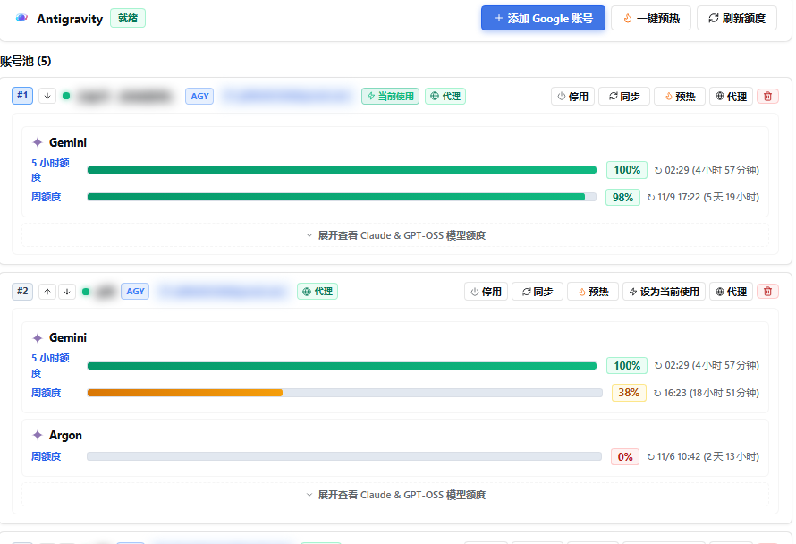
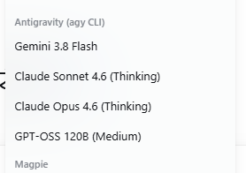
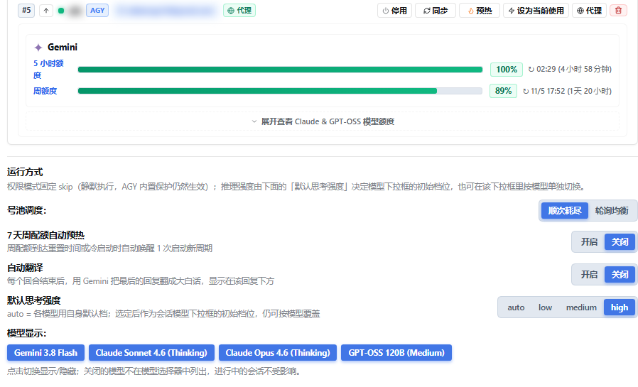

# dsh-agy-link — Español

Integra Google Antigravity en DeepSeek Harness (DSH). El plugin controla el CLI oficial y sin modificar `agy` y añade pool de cuentas, seguimiento oficial de cuotas por bucket, streaming nativo con tarjetas de herramientas y reescritura en lenguaje llano con `/tsl`.

<p align="center">
  
</p>

<p align="center">
  
  &nbsp;&nbsp;
  
</p>

## Descripción general

Cada turno lanza el proceso oficial `agy`, analiza su flujo de eventos NDJSON y lo traduce a texto, razonamiento, tarjetas de herramientas y medición de tokens nativos de DSH. La rotación de cuentas, la consulta de cuotas y los reintentos ocurren dentro del plugin; DSH solo ve una llamada normal al modelo.

- Varias cuentas de Google se consumen en orden, así una conversación sobrevive al agotamiento de una cuota.
- Las cuotas provienen del endpoint oficial: ventana de 5 horas, ventana semanal y el pool Argon de pago se muestran por separado.
- El razonamiento, los comandos de terminal y las ediciones de archivos se renderizan como tarjetas nativas de DSH.
- `/tsl` reescribe cualquier respuesta en lenguaje llano cuando un modelo escribe demasiado formal.

## Requisitos

| Requisito | Verificación |
| --- | --- |
| DSH | `dsh --version` |
| Node.js ≥ 24 | `node --version` |
| Google Antigravity CLI | `agy --version` |
| Conectividad con Google | proxy / VPN / TUN cuando sea necesario |

Donde Google no sea accesible directamente, active el proxy del sistema o el modo TUN. Si la terminal no hereda el proxy, expórtelo antes de iniciar DSH:

```bash
export HTTPS_PROXY=http://127.0.0.1:7890 HTTP_PROXY=http://127.0.0.1:7890 ALL_PROXY=socks5://127.0.0.1:7890
```

Sustituya el puerto por el de su proxy local. También puede configurar un proxy dedicado por cuenta desde la consola.

## Instalación e inicio rápido

```bash
dsh plugin --profile web add dsh-agy-link
dsh web
```

En DSH, haga clic en la insignia `AGY (n)` y elija "Add account" para completar el login de Google en el navegador; no hay que copiar ningún código de autorización. También puede ejecutar `/agy auth` para la cuenta principal. Después seleccione un modelo de Antigravity en `/model` y empiece a conversar. `/agy status` informa del estado actual.

## Funciones principales

- **Pool de cuentas**: HOME y credenciales OAuth aislados por cuenta; failover secuencial ante 429 o agotamiento; rotación que prioriza la cuota que caduca antes; enfriamiento por familia de modelos; cambio manual; proxy por cuenta; concesiones de credenciales en paralelo.
- **Cuotas oficiales**: 5 horas móviles, 7 días semanales y el pool semanal Argon, con cuenta atrás de reinicio y detalle por modelo.
- **Consola y ajustes**: la insignia `AGY (n)` de la cabecera y Ajustes → Plugins → Antigravity abren la misma consola. Dentro: tarjeta de cuenta (proxy, activar, precalentar, eliminar), nota de ejecución (permiso fijo en `skip`), planificación del pool (agotamiento secuencial / round robin), precalentamiento semanal de 7 días, traducción automática, esfuerzo de razonamiento por defecto y visibilidad de modelos. El selector lista los modelos bajo `Antigravity (agy CLI)`: Gemini 3.8 Flash, Claude Sonnet 4.6 (Thinking), Claude Opus 4.6 (Thinking), GPT-OSS 120B (Medium). Por debajo de 680px la consola pasa a ser una hoja a pantalla completa, con las etiquetas apiladas y las barras de cuota a todo el ancho.
- **Integración nativa**: proveedor `antigravity` en `/model` con las familias Gemini, Claude, GPT-OSS y Argon; streaming de texto, razonamiento y actividad de herramientas; tarjetas de terminal y diff, con las meta-herramientas MCP desenvueltas; diagramas mermaid; continuidad de sesión con `--conversation`; reenvío de goal y plan; medición completa de tokens con contexto de 1M; imágenes multimodales; delegación con `agy_ask`.
- **Aprendizaje de effort**: un modelo que rechaza `--effort` se reintenta una vez sin la opción y se recuerda en `~/.dsh/agy-link/effort-unsupported.json`; una incompatibilidad nunca hace fallar un turno.
- **Traducción `/tsl`**: comando, modo automático opcional y una acción por respuesta; el resultado se guarda como tarjeta bajo la respuesta, conserva el original y nunca entra en el historial visible para el modelo; usa el mismo pool con failover.

## Comandos `/agy`

`status`, `pool` / `accounts`, `auth` / `auth-code`, `add-account` / `remove-account`, `enable-account` / `disable-account`, `refresh-quota` / `clear-cooldown`, `models`, `mode`, `effort`, `dispatch` / `dispatch-retries` / `parallel` / `max-concurrent`, `workspace`, `goal`, `session`, `clear`, `doctor`.

## Uso de `/tsl`

```
/tsl                       # traduce el último turno completado
/tsl 3                     # traduce el turno 3
/tsl --full                # incluye la narración intermedia
/tsl --text 任意文本…       # traduce texto arbitrario (sin tarjeta)
/tsl --model claude-sonnet-5-5 --effort medium
/tsl auto on|off|status    # modo automático por sesión
```

## Configuración

Claves habituales: `enabled`, `agyBin`, `permissionMode` (por defecto `skip`), `defaultModel`, `defaultEffort` (por defecto `high`), `hiddenModels`, `timeoutMs`, `workspaceRoot`, `proxyUrl`, `suppressAgyAutoUpdate`, `autoWarmup`, `autoTranslate`, `translateModel`, `translateEffort`. La lista completa de claves, variables de entorno y valores por defecto está en [CONFIGURATION.md](./CONFIGURATION.md).

## Seguridad y condiciones

El plugin solo invoca el binario oficial y sin modificar `agy` instalado localmente. Su uso está sujeto a las condiciones del servicio de Google Antigravity.

## Licencia

MIT License.
