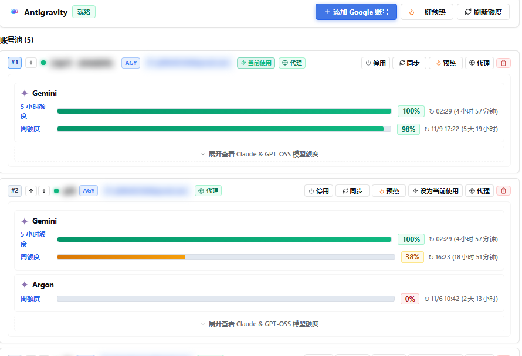
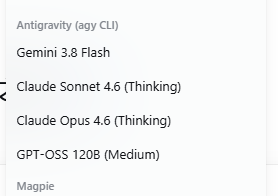
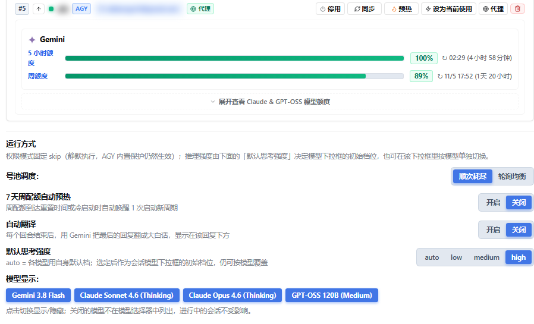

# dsh-agy-link — Português (Brasil)

Integre o Google Antigravity ao DeepSeek Harness (DSH). O plugin controla o CLI oficial e não modificado `agy` e adiciona pool de contas, acompanhamento oficial de cotas por bucket, streaming nativo com cartões de ferramentas e reescrita em linguagem simples com `/tsl`.

<p align="center">
  
</p>

<p align="center">
  
  &nbsp;&nbsp;
  
</p>

## Visão geral

Cada turno inicia o processo oficial `agy`, analisa seu fluxo de eventos NDJSON e o converte em texto, raciocínio, cartões de ferramentas e medição de tokens nativos do DSH. A rotação de contas, a consulta de cotas e as novas tentativas acontecem dentro do plugin; o DSH apenas vê uma chamada normal ao modelo.

- Várias contas do Google são consumidas em ordem, então uma conversa sobrevive ao esgotamento de uma cota.
- As cotas vêm do endpoint oficial: janela de 5 horas, janela semanal e o pool Argon pago são exibidos separadamente.
- Raciocínio, comandos de terminal e edições de arquivos aparecem como cartões nativos do DSH.
- O `/tsl` reescreve qualquer resposta em linguagem simples quando o modelo escreve de forma formal demais.

## Requisitos

| Requisito | Verificação |
| --- | --- |
| DSH | `dsh --version` |
| Node.js ≥ 24 | `node --version` |
| Google Antigravity CLI | `agy --version` |
| Conectividade com o Google | proxy / VPN / TUN quando necessário |

Onde o Google não for acessível diretamente, ative o proxy do sistema ou o modo TUN. Se o terminal não herdar o proxy, exporte-o antes de iniciar o DSH:

```bash
export HTTPS_PROXY=http://127.0.0.1:7890 HTTP_PROXY=http://127.0.0.1:7890 ALL_PROXY=socks5://127.0.0.1:7890
```

Substitua a porta pela do seu proxy local. Também é possível configurar um proxy dedicado por conta no console.

## Instalação e início rápido

```bash
dsh plugin --profile web add dsh-agy-link
dsh web
```

No DSH, clique no selo `AGY (n)` e escolha "Add account" para concluir o login do Google no navegador; não é preciso copiar nenhum código de autorização. Como alternativa, execute `/agy auth` para a conta principal. Depois selecione um modelo do Antigravity em `/model` e comece a conversar. O `/agy status` informa o estado atual.

## Principais recursos

- **Pool de contas**: HOME e credenciais OAuth isolados por conta; failover sequencial em caso de 429 ou esgotamento; rotação que prioriza a cota que expira antes; resfriamento por família de modelos; troca manual; proxy por conta; concessões de credenciais em paralelo.
- **Cotas oficiais**: 5 horas móveis, 7 dias semanais e o pool semanal Argon, com contagem regressiva de reinício e detalhe por modelo.
- **Console e configurações**: o selo `AGY (n)` no cabeçalho e Configurações → Plugins → Antigravity abrem o mesmo console. Dentro: cartão da conta (proxy, ativar, pré-aquecer, remover), nota de execução (permissão fixa em `skip`), agendamento do pool (esgotamento sequencial / round robin), pré-aquecimento semanal de 7 dias, tradução automática, esforço de raciocínio padrão e visibilidade de modelos. O seletor lista os modelos em `Antigravity (agy CLI)`: Gemini 3.8 Flash, Claude Sonnet 4.6 (Thinking), Claude Opus 4.6 (Thinking), GPT-OSS 120B (Medium). Abaixo de 680px o console vira uma folha de tela cheia, com rótulos empilhados e barras de cota em largura total.
- **Integração nativa**: provedor `antigravity` em `/model` com as famílias Gemini, Claude, GPT-OSS e Argon; streaming de texto, raciocínio e atividade de ferramentas; cartões de terminal e diff, com as meta-ferramentas MCP desembrulhadas; diagramas mermaid; continuidade de sessão com `--conversation`; encaminhamento de goal e plan; medição completa de tokens com contexto de 1M; imagens multimodais; delegação com `agy_ask`.
- **Aprendizado de effort**: um modelo que recusa `--effort` é repetido uma vez sem a opção e fica registrado em `~/.dsh/agy-link/effort-unsupported.json`; uma incompatibilidade nunca faz um turno falhar.
- **Tradução `/tsl`**: comando, modo automático opcional e uma ação por resposta; o resultado é persistido como um cartão abaixo da resposta, mantém o original e nunca entra no histórico visível ao modelo; usa o mesmo pool com failover.

## Comandos `/agy`

`status`, `pool` / `accounts`, `auth` / `auth-code`, `add-account` / `remove-account`, `enable-account` / `disable-account`, `refresh-quota` / `clear-cooldown`, `models`, `mode`, `effort`, `dispatch` / `dispatch-retries` / `parallel` / `max-concurrent`, `workspace`, `goal`, `session`, `clear`, `doctor`.

## Uso do `/tsl`

```
/tsl                       # traduz o último turno concluído
/tsl 3                     # traduz o turno 3
/tsl --full                # inclui a narração intermediária
/tsl --text 任意文本…       # traduz texto arbitrário (sem cartão)
/tsl --model claude-sonnet-5-5 --effort medium
/tsl auto on|off|status    # modo automático por sessão
```

## Configuração

Chaves comuns: `enabled`, `agyBin`, `permissionMode` (padrão `skip`), `defaultModel`, `defaultEffort` (padrão `high`), `hiddenModels`, `timeoutMs`, `workspaceRoot`, `proxyUrl`, `suppressAgyAutoUpdate`, `autoWarmup`, `autoTranslate`, `translateModel`, `translateEffort`. A lista completa de chaves, variáveis de ambiente e padrões está em [CONFIGURATION.md](./CONFIGURATION.md).

## Segurança e termos

O plugin invoca apenas o binário oficial e não modificado `agy` instalado localmente. O uso está sujeito aos Termos de Serviço do Google Antigravity.

## Licença

MIT License.
